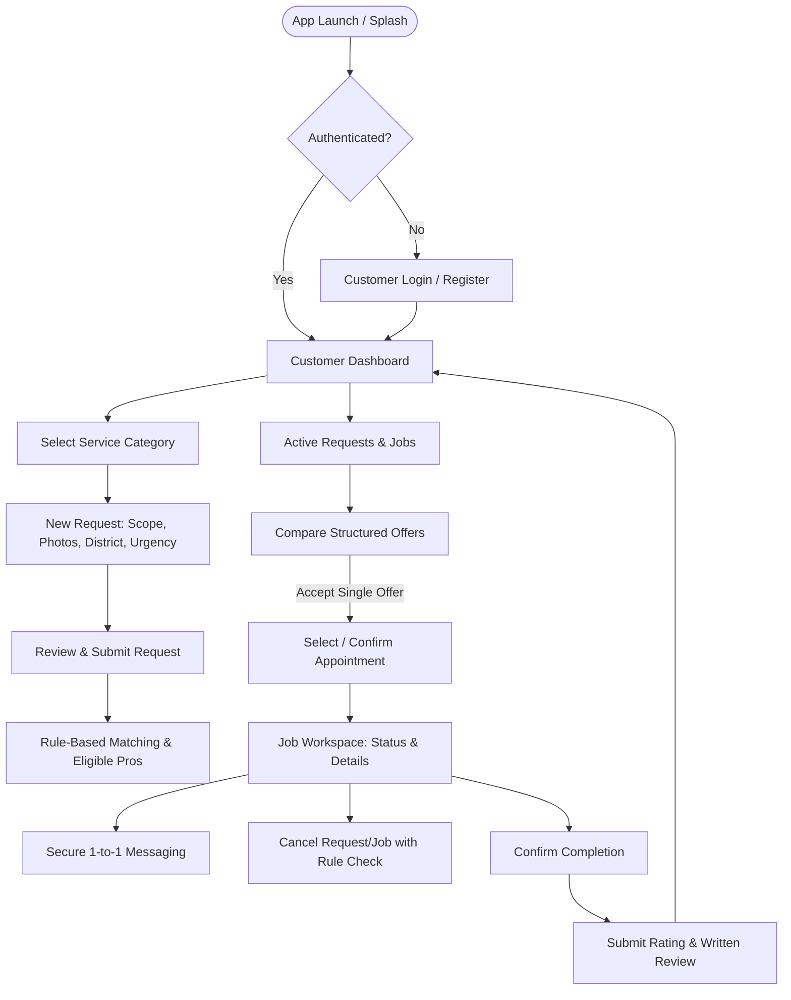
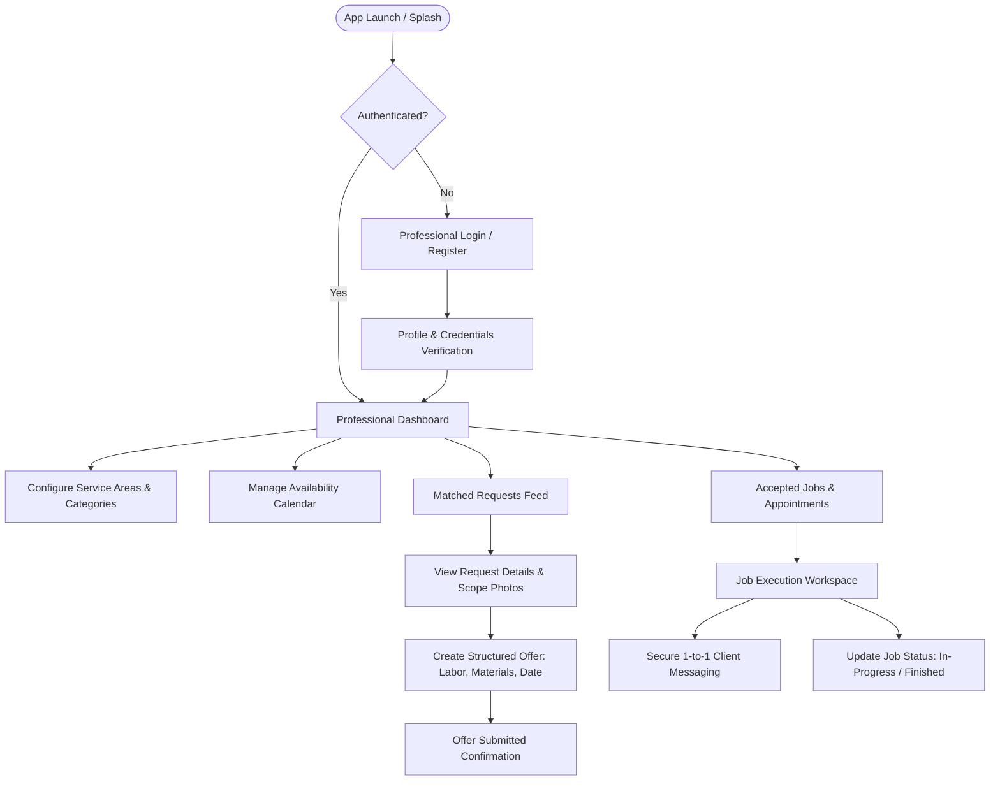
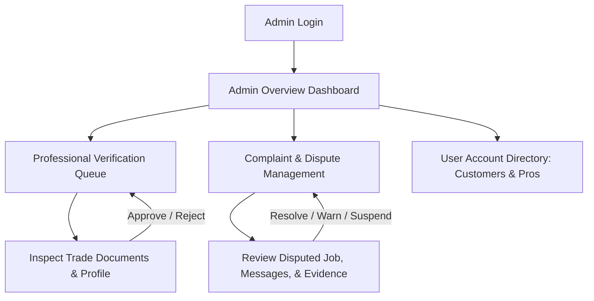
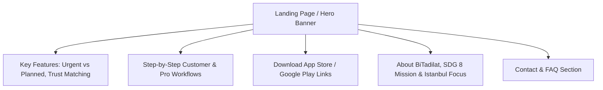

# BiTadilat - Requirements Analysis Document (RAD)
## Frontend & System Contributions: Section 3.3, Section 3.4, Section 5, and Section 6
**Author / Contributor:** Ata Herdem Atay (22soft1004) - Frontend / Mobile Member (WP4 Lead)  
**Project:** BiTadilat – A Location-Based Mobile Platform for Home Repair and Renovation Service Matching and Management  
**Course:** COMP/SOFT4902/4912 Graduation Design Project, Department of Software Engineering, Işık University  

---

# 3.3. Nonfunctional Requirements

### 3.3.1. Usability Requirements

Usability is critical to the adoption and operational effectiveness of BiTadilat, as the system serves two distinct user demographics with disparate technological proficiencies: everyday residential customers seeking swift solutions and local service professionals who interact with the system on mobile devices under varying field conditions. The usability requirements comply with **ISO 9241-11** (Effectiveness, Efficiency, and Satisfaction) and **Nielsen’s Usability Heuristics**.

1. **Unassisted Task Completion (Effectiveness):**
   * In formal usability evaluations involving at least five representative users (customers and service professionals), at least **80% of core tasks** must be accomplished without verbal, written, or technical intervention.
   * Core tasks include: publishing a service request with photos, reviewing and accepting a structured offer, scheduling an appointment, updating job completion status, and submitting a verified post-job rating.

2. **Learnability and Efficiency:**
   * **First-time Customer Flow:** A first-time customer shall be able to complete a service request (category selection, description, urgency designation, district selection, and photo upload) in **less than 3 minutes**.
   * **Professional Offer Submission:** A service professional shall be able to evaluate an incoming service request and submit a structured offer (labor cost, material estimate, earliest availability, and notes) in **under 90 seconds** using streamlined input selectors.

3. **Bilingual Interface Consistency (Turkish and English):**
   * The complete user interface across mobile and web platforms shall support dynamic localization in **Turkish (TR)** and **English (EN)**.
   * Switching languages must take effect immediately across all application chrome, navigation labels, status badges, forms, and validation dialogues without reloading the app or causing layout truncation.
   * Localization keys must strictly maintain semantic equivalence, ensuring that legal confirmations, status meanings, and pricing disclaimers are unambiguous in both languages.

4. **Error Prevention and Recovery:**
   * Form inputs (e.g., photo file sizes, contact phone formatting, service scope descriptions, pricing numerals) must incorporate real-time client-side validation with actionable inline error messages before network transmission.
   * Irreversible operational actions (e.g., accepting an offer, canceling a confirmed appointment, finalizing job completion) must enforce a two-step explicit confirmation dialog explaining the irreversible state transition.

5. **Accessibility and Touch Ergonomics:**
   * Mobile touch targets (buttons, list selectors, date/time pickers) must conform to a minimum interactive area of **48 × 48 dp (density-independent pixels)** to support one-handed field operation by professionals wearing work gloves or operating in low-light environments.
   * Contrast ratios between foreground typography and background containers must exceed **4.5:1 for body text** and **3.0:1 for large display headers**, fulfilling WCAG 2.1 Level AA standards.

6. **Transparency and Trust Representation:**
   * Matching result screens must present trust indicators clearly, including badge verifications, aggregate rating scores (out of 5.0), and the exact number of completed jobs in the relevant category.
   * The platform must make matching factors completely explicit to the customer (e.g., "Matched based on: Kadıköy District Coverage & Available Thursday Afternoon").

---

### 3.3.2. Sustainable Development Goals (SDG) Alignment

BiTadilat directly supports the United Nations 2030 Agenda for Sustainable Development, concentrating its socio-economic impact on two primary goals: **SDG 8 (Decent Work and Economic Growth)** and **SDG 11 (Sustainable Cities and Communities)**.

#### 1. SDG 8 – Decent Work and Economic Growth
* **Target 8.3:** *Promote development-oriented policies that support productive activities, decent job creation, entrepreneurship, creativity, and innovation, and encourage the formalization and growth of micro-, small- and medium-sized enterprises.*
  * **System Contribution:** The informal home maintenance sector in Istanbul frequently subjects independent repairmen, plumbers, electricians, and renovation contractors to irregular work acquisition, predatory broker markups, and unverified work agreements. BiTadilat directly contributes to Target 8.3 by equipping local micro-contractors and solo tradespeople with a free-to-access digital workspace. The structured offer framework and verified portfolio history allow quality-oriented craftsmen to build transparent digital reputations, secure steady service requests directly in their immediate residential vicinities, and operate with formalized, verifiable agreements without intermediaries.
* **Target 8.5:** *By 2030, achieve full and productive employment and decent work for all women and men, including for young people and persons with disabilities, and equal pay for work of equal value.*
  * **System Contribution:** By removing subjective physical gatekeepers and middleman monopolies, BiTadilat provides an equitable, rule-based matching mechanism. Professionals are matched strictly on objective criteria: verified qualifications, declared service territories, verified past performance ratings, and schedule availability. This transparent playing field ensures equal access to customer demand for newly entered or independent young technicians.

#### 2. SDG 11 – Sustainable Cities and Communities
* **Target 11.a:** *Support positive economic, social and environmental links between urban, peri-urban and rural areas by strengthening national and regional development planning.*
  * **System Contribution:** Rapid urban growth in Istanbul causes severe cross-district traffic congestion and transit delays. BiTadilat confines matching and service territory allocation to specific municipal districts and neighborhoods (e.g., Beşiktaş, Kadıköy, Üsküdar). Restricting service matching to hyper-local areas minimizes redundant cross-city technician transit, drastically reduces transit-induced fuel emissions, and fosters self-sustaining neighborhood service ecosystems.

#### 3. Environmental Mitigation Strategy (Negative Impact Analysis)
* **Carbon and Digital Energy Footprint:** Like any cloud-hosted digital platform, continuous background processing, server runtime, and media uploads generate electrical consumption. To mitigate this impact, BiTadilat enforces strict client-side image compression before upload (limiting photo payload sizes), utilizes lightweight RESTful API payloads with aggressive caching for static district metadata, and avoids high-energy continuous background geolocation tracking or energy-intensive real-time GPS telemetry.

---

# 3.4. System Models: User Interface, Navigational Paths, and Screen Mock-ups

This section details the user experience architecture of the BiTadilat platform across its four presentation pillars:
1. **Customer Mobile Application**
2. **Service Professional Mobile Application**
3. **Administrator Web Panel**
4. **Promotional Showcase Website**

---

### 3.4.1. Navigational Paths (Screen Flow Architecture)

#### A. Customer Mobile Application Flow


#### B. Service Professional Mobile Application Flow


#### C. Administrator Web Panel Flow


#### D. Promotional Website Flow


---

### 3.4.2. Screen Mock-ups and Interface Specifications

Below are the structural wireframes and interface specifications for the principal screens across all client touchpoints.

#### 1. Customer Mobile Interface: Create Service Request (Screen C-02)

```
+-------------------------------------------------------------+
|  <- Back              New Service Request          [TR / EN] |
+-------------------------------------------------------------+
|  1. Select Category                                         |
|  [ Plumbing (Selected) ]  [ Electrical ]  [ Painting ] ...  |
|                                                             |
|  2. Urgency Level                                           |
|  (o) Urgent (Immediate Response Needed)                     |
|  ( ) Planned Renovation (Scheduled for Future Date)         |
|                                                             |
|  3. Location (Istanbul Only)                                |
|  District: [ Kadıköy                         v ]            |
|  Neighborhood: [ Moda Mahallesi              v ]            |
|  (Exact building/apartment hidden until offer acceptance)   |
|                                                             |
|  4. Problem Description                                     |
|  +-------------------------------------------------------+  |
|  | Water pipe leaking underneath the bathroom sink.      |  |
|  | Requires replacement of valve and sealing.            |  |
|  +-------------------------------------------------------+  |
|                                                             |
|  5. Visual Evidence (Max 3 Photos)                          |
|  +-------------+  +-------------+  +---------------------+  |
|  | [Photo 1] x |  | [Photo 2] x |  | [ + Add Photo ]     |  |
|  +-------------+  +-------------+  +---------------------+  |
|                                                             |
|  [            Find Matching Professionals (Submit)        ] |
+-------------------------------------------------------------+
```
* **Key Validations:** Prevents submission if category, district, or description (< 15 characters) is omitted. Photos are client-compressed to $\le 1.5\text{ MB}$.

---

#### 2. Customer Mobile Interface: Rule-Based Matching & Trust Indicators (Screen C-03)

```
+-------------------------------------------------------------+
|  <- Back              Matching Specialists         [Filter] |
+-------------------------------------------------------------+
|  Request: Plumbing Repair - Kadıköy (Urgent)                |
|  3 Eligible Specialists Found in Your Vicinity              |
|                                                             |
|  +-------------------------------------------------------+  |
|  | Mehmet Usta - Kadıköy Tesisat            [VERIFIED ✓] |  |
|  | ★ 4.9 (42 completed jobs) | Response: ~15 mins        |  |
|  | Matching factors:                                     |  |
|  | • Operates in Kadıköy / Moda                          |  |
|  | • Declared Available: Today                           |  |
|  | [ View Profile ]             [ Request Direct Offer ] |  |
|  +-------------------------------------------------------+  |
|                                                             |
|  +-------------------------------------------------------+  |
|  | Ahmet Usta - Su & Doğalgaz               [VERIFIED ✓] |  |
|  | ★ 4.7 (19 completed jobs) | Response: ~30 mins        |  |
|  | Matching factors:                                     |  |
|  | • Operates in Kadıköy & Üsküdar                       |  |
|  | • Declared Available: Today                           |  |
|  | [ View Profile ]             [ Request Direct Offer ] |  |
|  +-------------------------------------------------------+  |
|                                                             |
|  (i) Address and private contact details remain confidential|
|      until you accept a professional's offer.               |
+-------------------------------------------------------------+
```
* **Key Features:** Clear display of trust indicators (Verified badge, star rating, verified completed job count) and explicit explanations of why the technician matches the criteria.

---

#### 3. Customer Mobile Interface: Structured Offer Comparison (Screen C-04)

```
+-------------------------------------------------------------+
|  <- Back              Offers for Request #1042     [TR / EN] |
+-------------------------------------------------------------+
|  Plumbing Repair - Leaking Pipe (Kadıköy)                   |
|  Comparing 2 Received Offers:                               |
|                                                             |
|  +-------------------------------------------------------+  |
|  | OFFER A: Mehmet Usta                   ★ 4.9 (42 jobs)|  |
|  | Total Estimated Price:  ₺1,250                        |  |
|  |   - Labor Cost:        ₺850                           |  |
|  |   - Estimated Parts:   ₺400                           |  |
|  | Earliest Arrival:      Today at 16:30                 |  |
|  | Scope / Note: Includes heavy-duty valve replacement   |  |
|  | [  ACCEPT THIS OFFER  ]        [ Decline Offer ]      |  |
|  +-------------------------------------------------------+  |
|                                                             |
|  +-------------------------------------------------------+  |
|  | OFFER B: Serkan Usta                   ★ 4.6 (14 jobs)|  |
|  | Total Estimated Price:  ₺1,100                        |  |
|  |   - Labor Cost:        ₺700                           |  |
|  |   - Estimated Parts:   ₺400                           |  |
|  | Earliest Arrival:      Tomorrow at 09:00              |  |
|  | Scope / Note: Standard brass fitting included          |  |
|  | [  ACCEPT THIS OFFER  ]        [ Decline Offer ]      |  |
|  +-------------------------------------------------------+  |
|                                                             |
|  [!] Once an offer is accepted, all other offers are closed |
|      and full service address will be shared with the pro.  |
+-------------------------------------------------------------+
```
* **Concurrency-Safe Rule:** When "ACCEPT THIS OFFER" is clicked, an atomic backend transaction locks the request. Any simultaneous acceptance attempt triggers an immediate status check, preventing dual confirmation.

---

#### 4. Service Professional Mobile Interface: Matched Request Feed & Offer Builder (Screen P-02)

```
+-------------------------------------------------------------+
|  BiTadilat Pro         Active Requests Feed        [Online] |
+-------------------------------------------------------------+
|  [ My Categories: Plumbing ] [ Territory: Kadıköy / Üsküdar ]|
|                                                             |
|  +-------------------------------------------------------+  |
|  | [URGENT] Water pipe leak under sink                      |  |
|  | Location: Kadıköy, Moda (~1.8 km away)                   |  |
|  | Posted: 12 minutes ago | Status: Open for Offers        |  |
|  | Photos: 2 Attached [Thumbnail 1] [Thumbnail 2]          |  |
|  |                                                       |  |
|  | --- Submit Structured Offer ---                       |  |
|  | Labor Fee:       [ ₺ 850        ]                     |  |
|  | Materials Fee:   [ ₺ 400        ]                     |  |
|  | Earliest Date:   [ 2026-10-14   ]  Time: [ 16:30    ] |  |
|  | Scope Notes:     [ Valve and seal replacement       ] |  |
|  |                                                       |  |
|  | [              Send Structured Offer                ] |  |
|  +-------------------------------------------------------+  |
+-------------------------------------------------------------+
```

---

#### 5. Common Mobile Interface: Active Job Workspace & In-App Messaging (Screen CP-05)

```
+-------------------------------------------------------------+
|  <- Back           Job #1042: Active Service       [Call SOS]|
+-------------------------------------------------------------+
|  Customer: Ata H.              Professional: Mehmet Usta    |
|  Status: [ IN PROGRESS - APPOINTMENT TODAY AT 16:30 ]       |
|  Service Address: Moda Cad. No: 14 D: 5, Kadıköy, Istanbul  |
|                                                             |
|  +-- Secure Messaging ------------------------------------+  |
|  | [16:05] Mehmet Usta: I am on my way, arriving in 15 min.|  |
|  | [16:06] Ata H.: Great, doorbell is marked 'Atay'.      |  |
|  | [16:22] Mehmet Usta: Arrived at location.              |  |
|  +--------------------------------------------------------+  |
|  [ Type message here...                         ] [ Send ]  |
|                                                             |
|  Action Controls:                                           |
|  [ Mark Job Completed ]             [ Request Cancellation ]|
+-------------------------------------------------------------+
```
* **Access Control:** Full address and direct messaging are strictly exposed only after offer acceptance. Cancelation rules enforce reason selection and prohibit cancelation once work is underway without admin mediation.

---

#### 6. Administrator Web Panel: Professional Verification & Dispute Handling (Screen A-01)

```
+------------------------------------------------------------------------------------------------+
|  BiTadilat Admin Panel  |  Dashboard  |  Pros Verification (3)  |  Complaints (1)  |  Logout   |
+------------------------------------------------------------------------------------------------+
|  Professional Verification Queue                                                               |
|  Showing pending contractor applications in Istanbul:                                         |
|                                                                                                |
|  Applicant Name   | Trade / Category | Districts Covered     | Documents Submitted | Action    |
|  -----------------+------------------+-----------------------+---------------------+---------- |
|  Mehmet Demir     | Plumbing         | Kadıköy, Ataşehir     | ID + Master Cert    | [Review]  |
|  Ali Kaya         | Electrical       | Beşiktaş, Şişli       | ID + Chamber Reg    | [Review]  |
|  Murat Yılmaz     | Renovation       | Maltepe, Kartal       | Tax Board + ID      | [Review]  |
|                                                                                                |
|  Reviewing Application: Mehmet Demir                                                           |
|  • Identity Card Check: MATCHED                                                                |
|  • Vocational Qualification Cert (Mesleki Yeterlilik Belgesi): #MYK-98421 - VALID              |
|  [  APPROVE APPLICATION  ]      [  REQUEST ADDITIONAL DOCS  ]      [  REJECT APPLICATION  ]    |
+------------------------------------------------------------------------------------------------+
|  Dispute & Complaint Center                                                                    |
|  Case #C-209 | Job #1012 | Filed by: Customer (Zeynep K.) against Pro (Emre T.)                |
|  Issue: Pro did not show up at scheduled appointment time without notification.               |
|  Chat Log & System Timestamp Audit: Pro was inactive 4 hours past appointment.                 |
|  [ Issue Warning to Pro ]       [ Cancel Job with Full Refund/Reset ]    [ Suspend Account ]   |
+------------------------------------------------------------------------------------------------+
```

---

#### 7. Promotional Website: Homepage & Feature Presentation (Screen W-01)

```
+------------------------------------------------------------------------------------------------+
|  BiTadilat LOGO          Features    How It Works    For Professionals    FAQ      [TR | EN]   |
+------------------------------------------------------------------------------------------------+
|                                                                                                |
|     Reliable Home Repairs & Renovations Across Istanbul.                                       |
|     Matched in minutes with verified local craftsmen. Transparent offers, zero hidden fees.    |
|                                                                                                |
|     [ Download on App Store ]        [ Get it on Google Play ]                                 |
|                                                                                                |
+------------------------------------------------------------------------------------------------+
|  WHY BITADILAT?                                                                                |
|                                                                                                |
|  [⚡ Urgent or Planned]     [✓ Verified Trust Badges]       [⚖ Structured Offers]              |
|  Need emergency plumbing     Review certifications, past     Compare itemized labor and         |
|  or scheduling a full room   ratings, and completed work     material estimates before          |
|  renovation? Pick your pace  history transparently.          accepting a binding contract.      |
|                                                                                                |
+------------------------------------------------------------------------------------------------+
|  HOW IT WORKS                                                                                  |
|  1. Post Your Need -> 2. Get Matched Locally -> 3. Compare Offers -> 4. Complete & Rate        |
|                                                                                                |
|  Proudly supporting Istanbul local craftsmen in line with UN SDG 8 (Decent Work & Growth).     |
|  (C) 2026 BiTadilat Project Team - Işık University Software Engineering                        |
+------------------------------------------------------------------------------------------------+
```

---

# 5. Glossary

* **Administrator:** An authorized platform manager responsible for verifying service professional credentials, monitoring system integrity, resolving user disputes and complaints, and maintaining account access privileges.
* **Appointment:** A mutually agreed upon date and time slot when a service professional visits the customer’s service address to perform an inspection or execute the contracted repair/renovation work.
* **BiTadilat:** The location-based software platform (comprising mobile applications, administrator panel, and promotional website) designed to match residential customers with verified repair and renovation professionals in Istanbul.
* **Completion Confirmation:** A formal state transition event occurring after the completion of physical service, wherein both the customer and service professional acknowledge the fulfillment of the agreed job scope.
* **Customer:** A registered end user on the BiTadilat platform who creates service requests, reviews and compares structured quotes, accepts offers, schedules appointments, and rates completed jobs.
* **Eligible Professional:** A registered service professional whose account is verified, whose declared operational districts include the request's location, whose categories match the request, and who has available schedule capacity.
* **Job:** The formal contract entity established immediately upon a customer accepting a specific professional’s structured offer, initiating appointments, messaging, and progress tracking.
* **Job Status:** The current milestone state of a service engagement within the system lifecycle (`Open`, `Offer Accepted`, `Appointment Scheduled`, `In Progress`, `Completed`, `Cancelled`, `Disputed`).
* **Navigational Path:** The logical and graphical progression of user interface screens traversed by an actor to accomplish a specific operational objective within the software application.
* **Non-Functional Requirement (NFR):** A quality attribute, operational standard, or structural constraint (such as usability, security, responsiveness, or localization) that the system must satisfy.
* **Planned Request:** A service request submitted for complex, non-emergency maintenance or renovation tasks to be executed at a predetermined future date.
* **Promotional Website:** A public-facing web presentation describing BiTadilat’s features, supported service categories, trust assurances, and mobile application download links.
* **Review & Rating:** A post-job evaluation submitted exclusively by a customer following confirmed job completion, consisting of a quantitative star rating (1.0 to 5.0) and qualitative feedback.
* **Role-Based Access Control (RBAC):** A security authorization mechanism enforcing permission boundaries based on whether an actor is a Customer, Service Professional, or Administrator, with secondary constraints based on active participation in a specific job.
* **Rule-Based Matching:** A deterministic algorithmic mechanism that filters and ranks professionals based on predefined criteria (category, geographic coverage, calendar availability, and verification status) without the use of non-deterministic machine learning.
* **Screen Mock-up:** A visual layout illustrating UI controls, information hierarchy, and actionable components planned for the software interfaces.
* **Service Area:** The designated municipal districts or neighborhoods in Istanbul within which a service professional agrees to accept and perform service requests.
* **Service Category:** The classified trade domain of a home repair task (e.g., Plumbing, Electrical, Painting, Carpentry, Masonry).
* **Service Professional (Pro):** A skilled tradesperson or contractor registered on BiTadilat to offer home repair and renovation services, submit quotes, and fulfill client jobs.
* **Service Request:** A customer-authored specification of required work containing category, description, photos, location district, and urgency.
* **Structured Offer:** An itemized, standardized bid submitted by a service professional containing labor cost, estimated materials cost, earliest availability, and scope clarification notes.
* **Sustainable Development Goals (SDGs):** The 17 global goals adopted by the United Nations in 2015 to promote environmental sustainability, social equity, and economic prosperity by 2030.
* **Trust Indicators:** Explicit credibility markers shown to customers, including identity/vocational verification badges, aggregate star ratings, and the number of verified completed jobs.
* **Urgent Request:** A high-priority service request for emergency home repair (e.g., burst pipes, power outage) requiring fast response times from nearby available technicians.

---

# 6. References

1. Bruegge, B., & Dutoit, A. H. (2010). *Object-Oriented Software Engineering Using UML, Patterns, and Java* (3rd ed.). Prentice Hall. ISBN: 978-0136061250.
2. International Organization for Standardization. (2018). *Ergonomics of human-system interaction — Part 11: Usability: Definitions and concepts* (ISO Standard No. 9241-11:2018). https://www.iso.org/standard/63500.html
3. Nielsen, J. (1994). *Usability Engineering*. Morgan Kaufmann Publishers Inc. ISBN: 978-0125184069.
4. World Wide Web Consortium (W3C). (2018). *Web Content Accessibility Guidelines (WCAG) 2.1*. W3C Recommendation. https://www.w3.org/TR/WCAG21/
5. Google LLC. (2023). *Material Design 3: Guidelines for Responsive Layouts and Mobile Ergonomics*. Material.io. https://m3.material.io/
6. Apple Inc. (2024). *Human Interface Guidelines: Designing for iOS and iPadOS*. Apple Developer Documentation. https://developer.apple.com/design/human-interface-guidelines/
7. United Nations, Department of Economic and Social Affairs. (2015). *Transforming our world: The 2030 Agenda for Sustainable Development (A/RES/70/1)*. United Nations. https://sdgs.un.org/goals
8. United Nations, Division for Sustainable Development Goals. (2023). *SDG 8: Promote sustained, inclusive and sustainable economic growth, full and productive employment and decent work for all*. UN DESA. https://sdgs.un.org/goals/goal8
9. United Nations, Division for Sustainable Development Goals. (2023). *SDG 11: Make cities and human settlements inclusive, safe, resilient and sustainable*. UN DESA. https://sdgs.un.org/goals/goal11
10. Sommerville, I. (2015). *Software Engineering* (10th ed.). Pearson. ISBN: 978-0133943030.
11. Pressman, R. S., & Maxim, B. R. (2020). *Software Engineering: A Practitioner's Approach* (9th ed.). McGraw-Hill Education. ISBN: 978-1259872976.
