# BiTadilat — Ev Onarım ve Tadilat Pazaryeri (Graduation Project)

> **Güven Odaklı, Doğrulanmış Usta ve Şeffaf Fiyatlandırma Modeline Sahip Yeni Nesil Ev Bakım ve Onarım Platformu**  
> *37 Ekran Bağlantılı İnteraktif Mobil Prototip, Orijinal Google Stitch Görselleri ve Kapsamlı Dokümantasyon*

---

## 📌 Proje Genel Bakışı (Overview)

**BiTadilat**, Türkiye şartlarına ve yerel dinamiklere göre sıfırdan modellenmiş, güven odaklı bir ev onarım ve mimari tadilat pazaryeridir. Kullanıcıların acil arızalarda (su baskını, sigorta atması vb.) veya planlı yenilemelerde (banyo, boya, mutfak) doğrulanmış ustalardan yapılandırılmış şeffaf teklifler almasını, teklifleri adil kriterlerle karşılaştırmasını, platform içi randevulaşıp mesajlaşmasını ve iş tamamlanana kadar ödemenin güvence havuzunda (escrow) korunduğu bir hizmet deneyimi sunar.

Bu depo, projenin **Kıdemli Product Manager (PM)** ve **Baş QA Test Mühendisi** standartlarında denetlenmiş, tüm rol sınırları kesin olarak ayrılmış, Google Stitch üzerindeki orijinal yüksek çözünürlüklü ekran tasarımlarını ve web tarayıcısı üzerinde gerçek bir mobil cihaz gibi çalışan **37 ekranlık bağlantılı interaktif prototipini** içermektedir.

---

## 🎨 Google Stitch Tasarım Sistemi Bilgileri (Design System Meta)

Proje Google Stitch üzerinde aşağıdaki kurumsal kimlik ve tasarım varlıkları ile üretilmiştir:

- **Stitch Proje ID:** `15188622157250602404` (*BiTadilat Onboarding App*)
- **Tasarım Sistemi Varlığı:** `assets/9358711b81524615a6a59e78b9dd0fc9` (*Usta Güvencesi*)
- **Temel Renk Paleti:**
  - `Deep Service Teal`: `#0F4C5C` (Birincil marka ve ana aksiyon rengi)
  - `Dark Teal`: `#0A3945` (Basılı ve koyu buton durumları)
  - `Trust Green`: `#107A5B` (Doğrulanmış usta rozetleri ve başarı durumları)
  - `Urgency Orange`: `#E87525` (Yalnızca acil onarım etiketleri)
  - `Canvas Background`: `#F7F8F6` (Sıcak açık gri-beyaz zemin)
  - `Surface`: `#FFFFFF` (Kartlar ve form alanları)
  - `Primary Text`: `#102A34` (Başlıklar ve ana metinler)
- **Tipografi:** Google Fonts Manrope (Türkçe karakter seti eksiksiz)
- **Dokunma Alanı:** Minimum 44×44 pt touch-target, 52 px birincil buton yüksekliği.

---

## 📸 37 Ekranlık Görsel Galeri (Stitch Visual Showcase)

Tüm 37 ekranın Google Stitch üzerinden çekilmiş tam çözünürlüklü PNG ekran görüntüleri depodaki [`screenshots/`](screenshots/) dizininde yer almaktadır:

### 🏠 1. Müşteri Akışı Ekranları (Customer Flow — 26 Ekran)

| **Adım 01: Hoş Geldiniz & Rol Seçimi (SCR-01)** | **Adım 02: Telefon Doğrulama** | **Adım 03: SMS Doğrulama Kodu** |
| :---: | :---: | :---: |
| 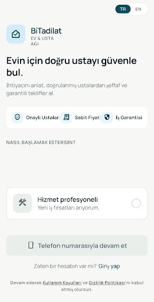 | 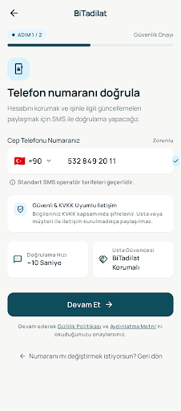 | 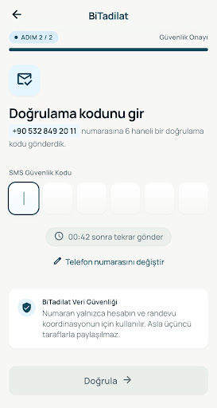 |

| **Adım 04: Müşteri Ana Sayfası (SCR-03)** | **Adım 05: Talep Adım 1/4: Hizmet & Öncelik (SCR-02)** | **Adım 06: Talep Adım 2/4: Konum & İş Detayı** |
| :---: | :---: | :---: |
| 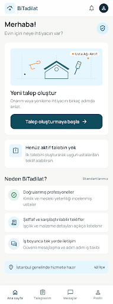 | 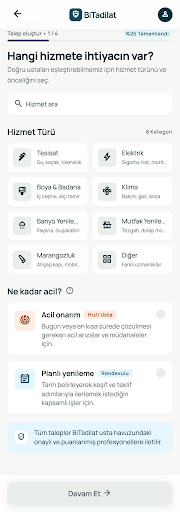 | 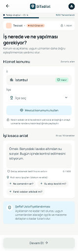 |

| **Adım 07: Talep Adım 3/4: Fotoğraflar & Ek Bilgi** | **Adım 08: Talep Adım 4/4: Talebi Gözden Geçir** | **Adım 09: Talep Yayınlandı — Teklif Bekleniyor** |
| :---: | :---: | :---: |
| 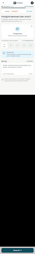 | 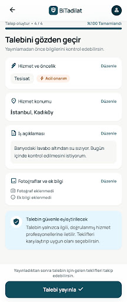 | 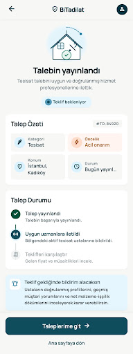 |

| **Adım 10: Müşteri Taleplerim Listesi (SCR-C-REQ)** | **Adım 11: Gelen Teklifler Listesi (SCR-04)** | **Adım 12: Teklif Detayı & Kapsam** |
| :---: | :---: | :---: |
| 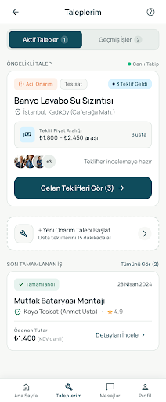 | 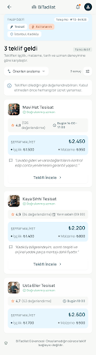 | 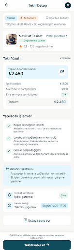 |

| **Adım 13: Teklifleri Karşılaştır (Matris)** | **Adım 14: Hizmet Profesyoneli Profili (SCR-05)** | **Adım 15: Teklif Kabul Onayı (Güvence Havuzu)** |
| :---: | :---: | :---: |
| 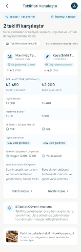 | 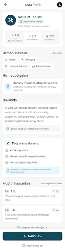 | 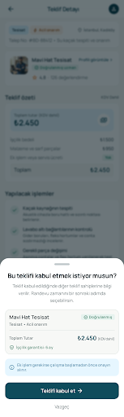 |

| **Adım 16: Randevu Zamanı Seç (SCR-06)** | **Adım 17: Randevu Talebi İletildi** | **Adım 18: İş Alanı — Randevu Onaylandı** |
| :---: | :---: | :---: |
| 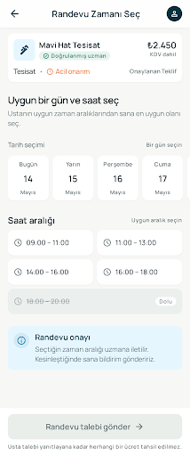 | 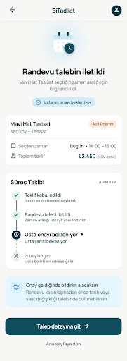 | 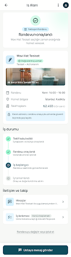 |

| **Adım 19: Usta ile Mesajlaşma (SCR-07)** | **Adım 20: İş Aşamaları ve İlerleme Takibi (SCR-08)** | **Adım 21: Randevu İptal / Değişiklik Talebi (SCR-09)** |
| :---: | :---: | :---: |
| 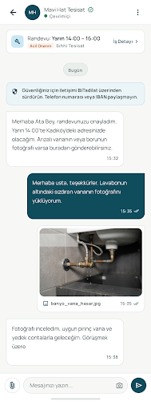 | 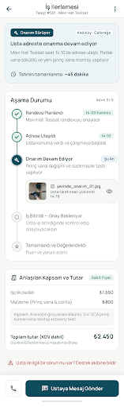 | 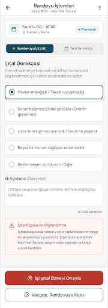 |

| **Adım 22: İş Tamamlama ve Teslim Onayı (SCR-10)** | **Adım 23: Hizmet Değerlendirme ve Puanlama (SCR-11)** | **Adım 24: Şikayet ve Uyuşmazlık Bildirimi (SCR-12)** |
| :---: | :---: | :---: |
| 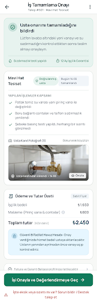 | 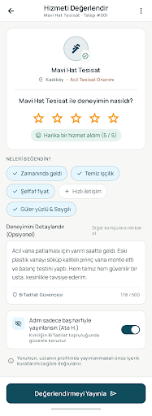 | 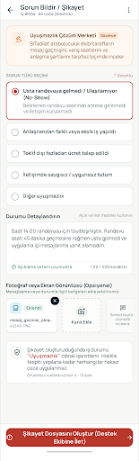 |

| **Adım 25: Şikayet İletildi ve Durum Takibi (SCR-13)** | **Adım 26: Müşteri Profil & Ayarlar (SCR-C-PROF)** |
| :---: | :---: |
| 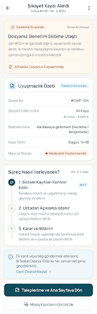 | 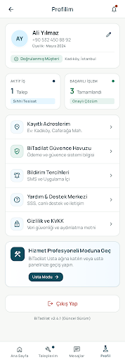 |


---

### 🛠️ 2. Hizmet Profesyoneli / Usta Akışı Ekranları (Pro Flow — 7 Ekran)

| **Adım 27: Usta Kayıt & Belge Yükleme (SCR-P-ONB)** | **Adım 28: Usta Eşleşen Talepler Akışı (SCR-14)** | **Adım 29: Usta Teklif Hazırlama (SCR-15)** |
| :---: | :---: | :---: |
| 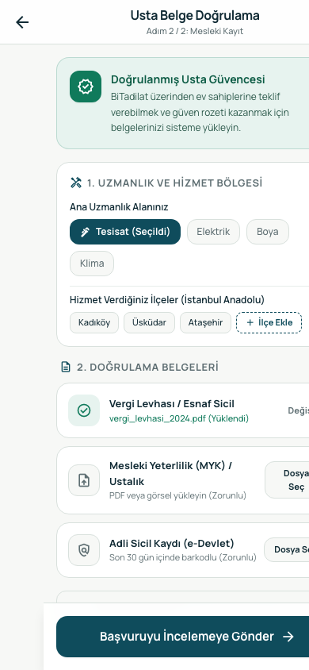 | 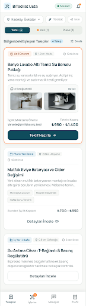 | 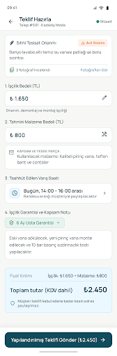 |

| **Adım 30: Usta Teklif Gönderildi Onayı (SCR-16)** | **Adım 31: Usta Profil & Müsaitlik Yönetimi (SCR-17)** | **Adım 32: Usta İş Yürütme & Aşama Yönetimi (SCR-18)** |
| :---: | :---: | :---: |
| 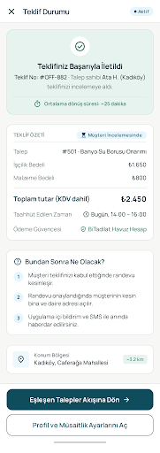 | 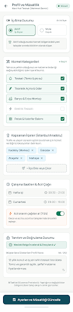 | 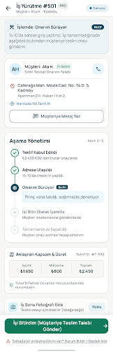 |

| **Adım 33: Usta Teslim Bildirimi İletildi (SCR-P-DONE)** |
| :---: |
| 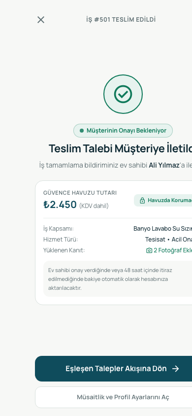 |


---

### 💻 3. Yönetici Portalı ve Karşılama Sitesi (Admin & Web — 4 Ekran)

| **Adım 34: Yönetici Web: Belge İnceleme (SCR-19)** | **Adım 35: Yönetici Web: Şikayet Merkezi (SCR-20)** | **Adım 36: Yönetici Web: Hesap Yönetimi (SCR-21)** |
| :---: | :---: | :---: |
| 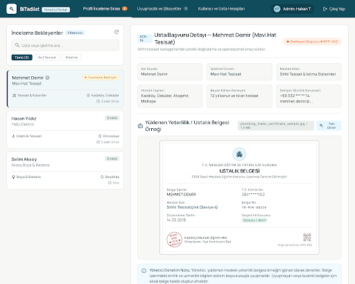 | 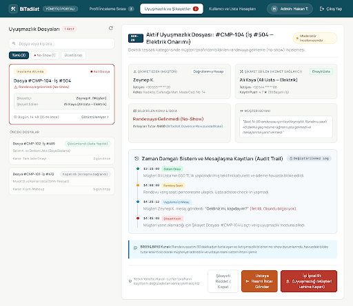 | 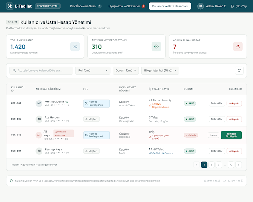 |

| **Adım 37: BiTadilat Tanıtım ve Karşılama Sitesi (SCR-22)** |
| :---: |
| 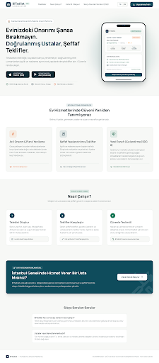 |


---

## 🚀 Hızlı Başlangıç ve Kurulum (Getting Started)

Proje hiçbir harici paket bağımlılığı veya karmaşık derleme adımı gerektirmez (**Zero-dependency**). Tamamen modern web standartları (HTML5, Tailwind CSS, Vanilla ES6+ JavaScript, Google Fonts & Material Symbols) ile inşa edilmiştir.

### 1. Seçenek: Doğrudan Tarayıcıda Açma (En Kolay)
Depoyu indirdikten veya klonladıktan sonra:
```bash
# macOS Terminal üzerinden
open preview/index.html
```
veya dosya yöneticisinden `preview/index.html` dosyasına çift tıklayarak varsayılan tarayıcınızda (Chrome, Safari, Edge, Firefox) anında başlatabilirsiniz.

### 2. Seçenek: Yerel HTTP Sunucusu ile Çalıştırma
Iframe ve tarayıcı yerel dosya (`file://`) güvenlik kısıtlamalarından tamamen izole olmak için yerel bir HTTP sunucusu açabilirsiniz:

```bash
# Depo dizinindeyken:
python3 -m http.server 3000

# Ardından tarayıcınızdan açın:
# http://localhost:3000/preview/index.html
```

---

## 📱 Web Üzerinde Mobil Görünüm Simülasyonu Taktikleri ve Teknik Detaylar

Web tarayıcısı üzerinde bir mobil uygulamanın doğal hissiyatını, kaydırma dinamiklerini ve ekranlar arası akışını birebir taklit etmek için kullanılan mimari teknikler ve taktikler:

### 1. Donanım Seviyesinde CSS Phone Shell (iPhone 15 Pro Çerçevesi)
- **Fiziksel Boyutlandırma:** Mobil ekranlar iOS standart referans viewport'u olan **`390px × 844px`** boyutunda sınırlandırılmıştır.
- **Dynamic Island & Durum Çubuğu:** Simülatörün tepe noktasında gerçekçi bir Dynamic Island kapsülü ile birlikte güncel saat (`09:41`), 4G sinyal gücü, Wi-Fi ve pil seviyesini simüle eden SVG/ikon durum çubuğu yer alır.
- **Home Indicator (Ana Ekran Çubuğu):** Alt kısımda modern iOS cihazların jest çubuğunu temsil eden `w-32 h-1` boyutunda yumuşatılmış home bar bulunur.
- **Çok Katmanlı Gölgelendirme (Phone Shadow):**  
  ```css
  box-shadow: 0 25px 60px -15px rgba(0, 0, 0, 0.9), 0 0 0 12px #1E293B, 0 0 0 14px #0F172A;
  ```
  Bu özel CSS gölgesi cihaz kasasını masaüstü zemininden kaldırarak gerçek bir telefon hissi yaratır.

### 2. Otonom Rota Yönlendirici ve İki Yönlü Mesajlaşma (PostMessage Protocol)
- **Ekranların Bağımsızlığı:** Her bir ekran (`preview/screens/*.html`) kendi başına çalışan, bağımsız DOM yapısına sahip tam bir HTML belgesidir.
- **Çift Yönlü İletişim:** İframe içindeki ekranlar buton tıklamalarını dış taşıyıcı simülatöre (`index.html`) `window.parent.postMessage` protokolü ile iletir:
  ```javascript
  window.parent.postMessage({
    type: 'NAVIGATE',
    from: CURRENT_SID,
    to: targetSid,
    label: 'Adım İlerlemesi'
  }, '*');
  ```
- **Faydası:** Tarayıcının ana sayfasının yenilenmesine gerek kalmadan yalnızca telefon çerçevesi içindeki iframe akıcı bir şekilde güncellenir.

### 3. Akıllı Cihaz Modu (Dynamic Responsive Switching)
- Sistem, açılan ekranın türünü (`MOBILE` vs `DESKTOP`) otomatik olarak algılar.
- **Masaüstü Ekranlar (Adım 34-37):** Yönetici Portalı ve Karşılama Sitesi gibi ekranlara gelindiğinde simülatör anında telefon çerçevesinden çıkıp **`1200px × 820px` Geniş Web Görünümüne** genişler ve masaüstü data tablolarını gösterir.
- **Mobil Ekranlar (Adım 01-33):** Kullanıcı mobil akışa geri döndüğünde simülatör anında iPhone telefon çerçevesine geri küçülür.

### 4. Deterministik Event Delegation ve Inline Kilit Baypasları
- Google Stitch veya ham arayüz üreticilerinin oluşturduğu inline `handleContinue()` gibi fonksiyonlar prototip akışını dondurabilir (örneğin butonun `pointer-events-none` ile kilitlenmesi).
- Her ekranın sonuna enjekte edilen **Authoritative Navigation Controller**, form submit engellemelerini (`e.preventDefault()`), butonların tıklanabilirlik kilitlerinin açılmasını (`cursor: pointer`, `removeAttribute('disabled')`) ve hedef ekranlara (`data-nav-target`) deterministik geçişi garanti altına alır.

---

## 👥 Çözülen Rol Çakışmaları ve QA Düzeltmeleri

Kapsamlı PM & QA denetiminde tespit edilip bu sürümde tamamen çözülen kritik noktalar:

1. **Müşteri Profil Sekmesi Ayrımı:** Müşteri ana sayfasındaki "Profil" sekmesi eskiden usta feed'ine geçiyordu. Artık yeni üretilen **`SCR-C-PROF` (Müşteri Profil & Ayarlar)** ekranı açılmaktadır.
2. **Ustanın Kendi İşini Onaylaması Engellendi:** Usta iş yürütme ekranındaki "İşi Bitirdim" butonu eskiden ustayı müşteri onay ekranına taşıyordu. Usta için özel **`SCR-P-DONE` (Usta Teslim Bildirimi İletildi)** ekranı üretildi ve usta kendi aktif iş havuzuna yönlendirildi.
3. **Usta Onboarding & Belge Yükleme:** Karşılama ekranında usta seçildiğinde doğrudan taleplere atlama hatası giderildi; **`SCR-P-ONB` (Usta Belge Yükleme)** ekranı eklendi.
4. **Taleplerim Sekmesi:** Artık tebrik kartı yerine **`SCR-C-REQ` (Müşteri Taleplerim & Aktif İşler Listesi)** açılmaktadır.
5. **Yasaklı Telefon Arama İkonları:** Platformda kesinlikle yasak olan doğrudan telefon arama butonları (`call` ikonu) `b89d99` ve `8ba8c3` ekranlarından silindi.
6. **Kategori Adı Standardizasyonu:** 9 ekranda kural dışı geçen "Sıhhi Tesisat" ifadeleri ürün standardı olan **"Tesisat"** olarak normalize edildi.

---

## 📁 Proje Dizin Yapısı (Project Directory)

```text
Grad_Project/
├── preview/
│   ├── index.html                 # 37 Ekran Bağlantılı Ana Mobil Simülatör
│   └── screens/                   # 37 Adet Bağımsız Ekran HTML Dosyaları (Canlı Kod)
├── screenshots/                   # 37 Ekranın Yüksek Çözünürlüklü Stitch PNG Görselleri
├── docs/
│   ├── QA_AUDIT_REPORT.md         # Detaylı 33 Ekran QA ve PM Denetim Raporu
│   └── QA_REMEDIATION_WALKTHROUGH.md # Tamamlanan İyileştirmeler ve Teslim Raporu
├── screens_map.json               # 37 Ekranın Rol, Başlık ve Cihaz Metadata Haritası
├── BI_TADILAT_AI_HANDOFF.md       # Ürün Tasarım & Handoff Kararları Dokümanı
├── BiTadilatDESIGN.md             # Kurumsal Tasarım Sistemi Şartnamesi
├── BiTadilatUI_UX_PROGRESS.md     # Ekran İlerleme ve Düzeltme Notları
├── BiTadilat_Requirements_Analysis_Document.md # Gereksinim Analiz Dokümanı (RAD)
├── build_authoritative_prototype.py # Ekran Kontrolörlerini Enjekte Eden Betik
├── generate_index_html.py         # Simülatörü Sıfırdan Üreten Python Betiği
├── download_and_sync_all_screenshots.py # Stitch Görsellerini İndiren Betik
├── .gitignore                     # Git Yoksayma Kuralları
└── README.md                      # Proje Ana Rehberi ve Görsel Vitrini
```

---

## 🛠️ Takım Arkadaşları İçin Çalışma ve Katkı Rehberi

1. **Yeni bir ekran eklemek isterseniz:**
   - Ekran HTML dosyasını `preview/screens/<ekran_id>.html` olarak ekleyin.
   - `build_authoritative_prototype.py` dosyasındaki `screens_spec` listesine yeni ekranın ID'sini, başlığını, rolünü (`CUSTOMER` / `PRO` / `ADMIN`), `back_sid` ve `next_sid` değerlerini ekleyin.
   - `python3 build_authoritative_prototype.py` ve `python3 generate_index_html.py` çalıştırarak navigasyon haritasını ve simülatörü saniyeler içinde otomatik olarak güncelleyin.
2. **Klavye Kısayolları ile Test:**
   - Simülatör açıkken klavyenizden `Alt + Sol Ok` veya `Alt + Sağ Ok` tuşlarına basarak ekranlar arasında sıralı olarak gezinebilirsiniz.
3. **Ekranı Yenilemek (Live Reload):**
   - İframe içindeki ekranı yenilemek için üst menüdeki `Yenile` (refresh) butonunu kullanabilirsiniz.

---

## 📄 Lisans ve Akademik Beyan
Bu proje, Lisans / Bitirme Projesi (Graduation Project) kapsamında geliştirilmiştir. Tüm telif hakları proje geliştiricilerine aittir.
