# BiTadilat — Ev Onarım ve Tadilat Pazaryeri (Graduation Project)

> **Güven Odaklı, Doğrulanmış Usta ve Şeffaf Fiyatlandırma Modeline Sahip Yeni Nesil Ev Bakım ve Onarım Platformu**  
> *37 Ekran Bağlantılı İnteraktif Mobil Prototip, Çift Rol Deneyimi ve Yönetici Web Portalı*

---

## 📌 Proje Genel Bakışı (Overview)

**BiTadilat**, Türkiye şartlarına ve yerel dinamiklere göre sıfırdan modellenmiş, güven odaklı bir ev onarım ve mimari tadilat pazaryeridir. Kullanıcıların acil arızalarda (su baskını, sigorta atması vb.) veya planlı yenilemelerde (banyo, boya, mutfak) doğrulanmış ustalardan yapılandırılmış şeffaf teklifler almasını, teklifleri adil kriterlerle karşılaştırmasını, platform içi randevulaşıp mesajlaşmasını ve iş tamamlanana kadar ödemenin güvence havuzunda (escrow) korunduğu bir hizmet deneyimi sunar.

Bu depo, projenin **Kıdemli Product Manager (PM)** ve **Baş QA Test Mühendisi** standartlarında denetlenmiş, tüm rol sınırları kesin olarak ayrılmış ve web tarayıcısı üzerinde gerçek bir mobil cihaz gibi çalışan **37 ekranlık bağlantılı interaktif prototipini** ve kapsamlı analiz dokümantasyonunu içermektedir.

---

## 🚀 Hızlı Başlangıç ve Kurulum (Getting Started)

Proje hiçbir harici paket bağımlılığı veya karmaşık derleme adımı gerektirmez (**Zero-dependency**). Tamamen modern web standartları (HTML5, Tailwind CSS, Vanilla ES6+ JavaScript, Google Fonts & Material Symbols) ile inşa edilmiştir.

### 1. Seçenek: Doğrudan Tarayıcıda Açma (En Kolay)
Depoyu indirdikten veya klonladıktan sonra:
```bash
# macOS Terminal üzerinden
open preview/index.html
```
veya dosya yöneticisinden `preview/index.html` dosyasına çift tıklayarak varsayılan tarayıcınızda (Chrome, Safari, Edge, Firefox) anında başlatabilirsiniz.

### 2. Seçenek: Yerel HTTP Sunucusu ile Çalıştırma
Iframe ve tarayıcı yerel dosya (`file://`) güvenlik kısıtlamalarından tamamen izole olmak için yerel bir HTTP sunucusu açabilirsiniz:

```bash
# Depo dizinindeyken:
python3 -m http.server 3000

# Ardından tarayıcınızdan açın:
# http://localhost:3000/preview/index.html
```

---

## 📱 Web Üzerinde Mobil Görünüm Simülasyonu Taktikleri ve Teknik Detaylar

Web tarayıcısı üzerinde bir mobil uygulamanın doğal hissiyatını, kaydırma dinamiklerini ve ekranlar arası akışını birebir taklit etmek için kullanılan mimari teknikler ve taktikler:

### 1. Donanım Seviyesinde CSS Phone Shell (iPhone 15 Pro Çerçevesi)
- **Fiziksel Boyutlandırma:** Mobil ekranlar iOS standart referans viewport'u olan **`390px × 844px`** boyutunda sınırlandırılmıştır.
- **Dynamic Island & Durum Çubuğu:** Simülatörün tepe noktasında gerçekçi bir Dynamic Island kapsülü ile birlikte güncel saat (`09:41`), 4G sinyal gücü, Wi-Fi ve pil seviyesini simüle eden SVG/ikon durum çubuğu yer alır.
- **Home Indicator (Ana Ekran Çubuğu):** Alt kısımda modern iOS cihazların jest çubuğunu temsil eden `w-32 h-1` boyutunda yumuşatılmış home bar bulunur.
- **Çok Katmanlı Gölgelendirme (Phone Shadow):**  
  ```css
  box-shadow: 0 25px 60px -15px rgba(0, 0, 0, 0.9), 0 0 0 12px #1E293B, 0 0 0 14px #0F172A;
  ```
  Bu özel CSS gölgesi cihaz kasasını masaüstü zemininden kaldırarak gerçek bir telefon hissi yaratır.

### 2. Otonom Rota Yönlendirici ve İki Yönlü Mesajlaşma (PostMessage Protocol)
- **Ekranların Bağımsızlığı:** Her bir ekran (`preview/screens/*.html`) kendi başına çalışan, bağımsız DOM yapısına sahip tam bir HTML belgesidir.
- **Çift Yönlü İletişim:** İframe içindeki ekranlar buton tıklamalarını dış taşıyıcı simülatöre (`index.html`) `window.parent.postMessage` protokolü ile iletir:
  ```javascript
  window.parent.postMessage({
    type: 'NAVIGATE',
    from: CURRENT_SID,
    to: targetSid,
    label: 'Adım İlerlemesi'
  }, '*');
  ```
- **Faydası:** Tarayıcının ana sayfasının yenilenmesine gerek kalmadan yalnızca telefon çerçevesi içindeki iframe akıcı bir şekilde güncellenir. Kullanıcı adımları simülatörün sol çekmecesinden veya üst breadcrumb barından canlı olarak takip edebilir.

### 3. Akıllı Cihaz Modu (Dynamic Responsive Switching)
- Sistem, açılan ekranın türünü (`MOBILE` vs `DESKTOP`) otomatik olarak algılar.
- **Masaüstü Ekranlar (Adım 34-37):** Yönetici Portalı ve Karşılama Sitesi gibi ekranlara gelindiğinde simülatör anında telefon çerçevesinden çıkıp **`1200px × 820px` Geniş Web Görünümüne** genişler ve masaüstü data tablolarını gösterir.
- **Mobil Ekranlar (Adım 01-33):** Kullanıcı mobil akışa geri döndüğünde simülatör anında iPhone telefon çerçevesine geri küçülür.

### 4. Deterministik Event Delegation ve Inline Kilit Baypasları
- Google Stitch veya ham arayüz üreticilerinin oluşturduğu inline `handleContinue()` gibi fonksiyonlar prototip akışını dondurabilir (örneğin butonun `pointer-events-none` ile kilitlenmesi).
- Her ekranın sonuna enjekte edilen **Authoritative Navigation Controller**, form submit engellemelerini (`e.preventDefault()`), butonların tıklanabilirlik kilitlerinin açılmasını (`cursor: pointer`, `removeAttribute('disabled')`) ve hedef ekranlara (`data-nav-target`) deterministik geçişi garanti altına alır.

---

## 👥 Ürün Mimarisi ve Rol Ayrımı (Role Architecture)

BiTadilat projesinde 3 ana kullanıcı grubu birbirinden kesin sınırlarla ayrılmıştır:

```mermaid
flowchart TD
    subgraph MUSTERI["🏠 Müşteri Deneyimi (26 Ekran)"]
        M_ONB["Giriş & SMS Doğrulama"] --> M_HOME["Müşteri Ana Sayfası"]
        M_HOME --> M_WIZ["4 Adımlı Talep Sihirbazı"]
        M_WIZ --> M_PUB["Talep Yayınlandı"]
        M_PUB --> M_OFFERS["Gelen Teklifler & Matris Karşılaştırma"]
        M_OFFERS --> M_APPT["Randevu Zamanı Seçimi"]
        M_APPT --> M_JOB["İş Alanı & İlerleme Takibi"]
        M_JOB --> M_DONE["Teslim Onayı & Puanlama"]
        M_JOB --> M_DISP["Uyuşmazlık & Şikayet"]
        M_HOME --> M_PROF["Müşteri Profil & Ayarlar"]
        M_HOME --> M_REQ["Taleplerim Listesi"]
    end

    subgraph USTA["🛠️ Hizmet Profesyoneli (Usta) Deneyimi (7 Ekran)"]
        U_ONB["Usta Kayıt & Belge Yükleme"] --> U_FEED["Eşleşen Talepler Akışı"]
        U_FEED --> U_OFFER["Teklif Hazırlama & Gönderim"]
        U_FEED --> U_AVAIL["Müsaitlik & Profil Yönetimi"]
        U_FEED --> U_EXEC["İş Yürütme & Aşama Yönetimi"]
        U_EXEC --> U_DONE["Teslim Bildirimi İletildi (Onay Bekleniyor)"]
    end

    subgraph ADMIN["💻 Yönetici Portalı & Web (4 Ekran)"]
        A_DOCS["Usta Belge İnceleme"]
        A_DISP["Şikayet & Uyuşmazlık Merkezi"]
        A_ACCOUNTS["Kullanıcı & Usta Hesap Yönetimi"]
        W_LAND["Tanıtım ve Karşılama Sitesi"]
    end

    style MUSTERI fill:#0F4C5C10,stroke:#0F4C5C,stroke-width:2px
    style USTA fill:#107A5B10,stroke:#107A5B,stroke-width:2px
    style ADMIN fill:#E8752510,stroke:#E87525,stroke-width:2px
```



### 1. 🏠 Müşteri Akışı (Customer Journey — 26 Ekran)
1. **Adım 01 - 03 (Giriş & Onboarding):** Karşılama ekranında rol seçimi ("Ev Sahibi" / "Usta"), telefon numarası girişi ve 6 haneli SMS doğrulama kodu.
2. **Adım 04 - 09 (Talep Sihirbazı):** Kategori ve aciliyet seçimi (Acil onarım vs. Planlı yenileme), ilçe ve en az 20 karakterlik iş detayı, en fazla 5 fotoğraf ekleme (opsiyonel), özet gözden geçirme ve talebi yayınlama.
3. **Adım 10 - 17 (Teklifler & Randevu):** Gelen teklifler listesi, şeffaf fiyat kırılımı (İşçilik + Malzeme + KDV dahil toplam), teklif karşılaştırma matrisi, usta profili inceleme, güvence havuzu ile teklif kabulü ve gün/saat randevu seçimi.
4. **Adım 18 - 25 (İş Takibi, Teslim & Şikayet):** Randevu onaylı iş alanı, usta ile platform içi mesajlaşma, iş aşamaları ilerleme takibi, randevu değişiklik/iptal talebi, müşteri iş tamamlama teslim onayı, 5 yıldızlı usta değerlendirme/puanlama ve şikayet/uyuşmazlık bildirim süreci.
5. **Adım 26 (Müşteri Profili):** Kayıtlı adresler, bildirimler, güvence havuzu rehberi ve güvenli "Usta Moduna Geç" geçişi.

### 2. 🛠️ Hizmet Profesyoneli / Usta Akışı (Pro Journey — 7 Ekran)
1. **Adım 27 (Usta Onboarding & Belge Yükleme):** Tesisat uzmanlık seçimi, hizmet verilen ilçeler, Vergi Levhası, MYK Ustalık Belgesi ve e-Devlet Adli Sicil Kaydı yükleme.
2. **Adım 28 (Usta Feed):** Bölgedeki eşleşen talepler akışı, Acil/Planlı filtreleri ve teklif verme kartları.
3. **Adım 29 - 30 (Teklif Hazırlama & Gönderim):** İşçilik, malzeme ve randevu aralığını belirten yapılandırılmış teklif oluşturma ve gönderim onayı.
4. **Adım 31 (Müsaitlik & Profil):** Haftalık çalışma saatleri ve hizmet bölgesi yönetimi.
5. **Adım 32 - 33 (İş Yürütme & Teslimat):** Sahada iş aşamalarını tamamlama, müşteriye mesaj atma, "İşi Bitirdim" teslim talebini gönderme ve güvence havuzu onay bekleme ekranı.

### 3. 💻 Yönetici Portalı & Web Sitesi (Admin & Landing — 4 Ekran)
1. **Adım 34 (Usta Belge İnceleme):** Yeni ustaların yüklediği vergi levhası ve ustalık diplomalarını tam ekran inceleme ve onay/red verme.
2. **Adım 35 (Uyuşmazlık Merkezi):** Müşteri ve usta arasındaki anlaşmazlıkları, kanıt fotoğraflarını ve chat kayıtlarını inceleyip çözüme bağlama.
3. **Adım 36 (Hesap Yönetimi):** Platformdaki tüm müşteri ve ustaları listeleyen, askıya alma/aktif etme aksiyonları sunan veri tablosu.
4. **Adım 37 (Tanıtım Web Sitesi):** Müşteriyi onarıma, ustaları sisteme katılmaya yönlendiren responsive landing page.

---

## 🎨 Tasarım Sistemi ve Kurallar (BiTadilat Design System)

Proje `BiTadilatDESIGN.md` dosyasında tanımlanan kurumsal kimliğe sıkı sıkıya bağlıdır:

| Renk İsmi | Hex Kodu | Kullanım Alanı |
| :--- | :--- | :--- |
| **Deep Service Teal** | `#0F4C5C` | Birincil marka rengi, ana aksiyon butonları, aktif sekmeler |
| **Dark Teal** | `#0A3945` | Buton basılı (pressed) ve hover durumları |
| **Trust Green** | `#107A5B` | Doğrulanmış usta rozetleri, tamamlanan adımlar, başarı onayları |
| **Urgency Orange** | `#E87525` | Yalnızca acil onarım etiketleri ve uyarılar (Yıkıcı butonlarda asla kullanılmaz) |
| **Alert Red** | `#B9382C` | Hatalar, şikayet durumları ve oturum kapatma aksiyonları |
| **Canvas Background** | `#F7F8F6` | Sıcak açık gri-beyaz zemin |
| **Surface** | `#FFFFFF` | Kartlar, form elemanları ve alt açılır sayfalar |
| **Primary Text** | `#102A34` | Başlıklar ve birincil gövde metinleri |
| **Secondary Text** | `#5F6F73` | İkincil açıklamalar, ipuçları ve etiketler |
| **Border Subtle** | `#D9E1DD` | Kart sınır çizgileri ve input kenarlıkları |

### Temel UI/UX Kuralları:
- **Tek Ana Eylem Kuralı (One Primary CTA):** Her ekranda yalnızca bir adet belirgin `#0F4C5C` ana aksiyon butonu bulunur.
- **Alt Navigasyon Kuralı:** Alt gezinme çubuğu (Bottom Nav) yalnızca oturum açılmış ana ekran seviyesinde (Müşteri Ana Sayfası, Taleplerim, Müşteri Profili ve Usta Feed) yer alır; formlarda, sihirbaz adımlarında ve onay modallarında asla gösterilmez.
- **Platform Dışı İletişim Yasağı:** Platformda doğrudan telefon arama butonları (`call` ikonu) veya telefon numarası paylaşımı yasaktır; tüm görüşmeler BiTadilat mesajlaşma ekranı üzerinden yürütülür.
- **Şeffaf Fiyatlandırma:** Fiyatlar her zaman "Toplam tutar (KDV dahil)" formatında gösterilir; "Net" ile "KDV dahil" asla karıştırılmaz.

---

## 📁 Proje Dizin Yapısı (Project Directory)

```text
Grad_Project/
├── preview/
│   ├── index.html                 # 37 Ekran Bağlantılı Ana Mobil Simülatör
│   └── screens/                   # 37 Adet Bağımsız Ekran HTML Dosyaları
│       ├── 0c06b06e...html        # SCR-01: Hoş Geldiniz & Rol Seçimi
│       ├── fbbe0f40...html        # Telefon Doğrulama
│       ├── 42c148a1...html        # SMS Doğrulama
│       ├── cc1f5566...html        # SCR-03: Müşteri Ana Sayfası
│       ├── 44c003fe...html        # Talep Adım 1: Hizmet & Öncelik
│       ├── ...                    # (Tüm müşteri ve usta ara adımları)
│       ├── 20de80b8...html        # SCR-C-PROF: Müşteri Profil Ekranı (YENİ)
│       ├── 86fe79e6...html        # SCR-C-REQ: Müşteri Taleplerim Listesi (YENİ)
│       ├── a512d092...html        # SCR-P-ONB: Usta Onboarding & Belge Yükleme (YENİ)
│       ├── c6ebf06d...html        # SCR-P-DONE: Usta Teslim Bildirimi İletildi (YENİ)
│       ├── 612429fd...html        # SCR-19: Yönetici Belge İnceleme (Web)
│       ├── cb00d677...html        # SCR-20: Yönetici Şikayet Merkezi (Web)
│       ├── 5ce8968e...html        # SCR-21: Yönetici Hesap Yönetimi (Web)
│       └── 164cd336...html        # SCR-22: BiTadilat Tanıtım Sitesi (Web)
├── docs/
│   ├── QA_AUDIT_REPORT.md         # Detaylı 33 Ekran QA ve PM Denetim Raporu
│   └── QA_REMEDIATION_WALKTHROUGH.md # Tamamlanan İyileştirmeler ve Teslim Raporu
├── screens_map.json               # 37 Ekranın Rol, Başlık ve Cihaz Metadata Haritası
├── BI_TADILAT_AI_HANDOFF.md       # Ürün Tasarım & Handoff Kararları Dokümanı
├── BiTadilatDESIGN.md             # Kurumsal Tasarım Sistemi Şartnamesi
├── BiTadilatUI_UX_PROGRESS.md     # Ekran İlerleme ve Düzeltme Notları
├── BiTadilat_Requirements_Analysis_Document.md # Gereksinim Analiz Dokümanı (RAD)
├── build_authoritative_prototype.py # Ekran Kontrolörlerini Enjekte Eden Betik
├── generate_index_html.py         # Simülatörü Sıfırdan Üreten Python Betiği
├── .gitignore                     # Git Yoksayma Kuralları
└── README.md                      # Proje Ana Rehberi (Bu dosya)
```

---

## 🛠️ Takım Arkadaşları İçin Çalışma ve Katkı Rehberi

1. **Yeni bir ekran eklemek isterseniz:**
   - Ekran HTML dosyasını `preview/screens/<ekran_id>.html` olarak ekleyin.
   - `build_authoritative_prototype.py` dosyasındaki `screens_spec` listesine yeni ekranın ID'sini, başlığını, rolünü (`CUSTOMER` / `PRO` / `ADMIN`), `back_sid` ve `next_sid` değerlerini ekleyin.
   - `python3 build_authoritative_prototype.py` ve `python3 generate_index_html.py` çalıştırarak navigasyon haritasını ve simülatörü saniyeler içinde otomatik olarak güncelleyin.
2. **Klavye Kısayolları ile Test:**
   - Simülatör açıkken klavyenizden `Alt + Sol Ok` veya `Alt + Sağ Ok` tuşlarına basarak ekranlar arasında sıralı olarak gezinebilirsiniz.
3. **Ekranı Yenilemek (Live Reload):**
   - İframe içindeki ekranı yenilemek için üst menüdeki `Yenile` (refresh) butonunu kullanabilirsiniz.

---

## 📄 Lisans ve Akademik Beyan
Bu proje, Lisans / Bitirme Projesi (Graduation Project) kapsamında geliştirilmiştir. Tüm telif hakları proje geliştiricilerine aittir.
