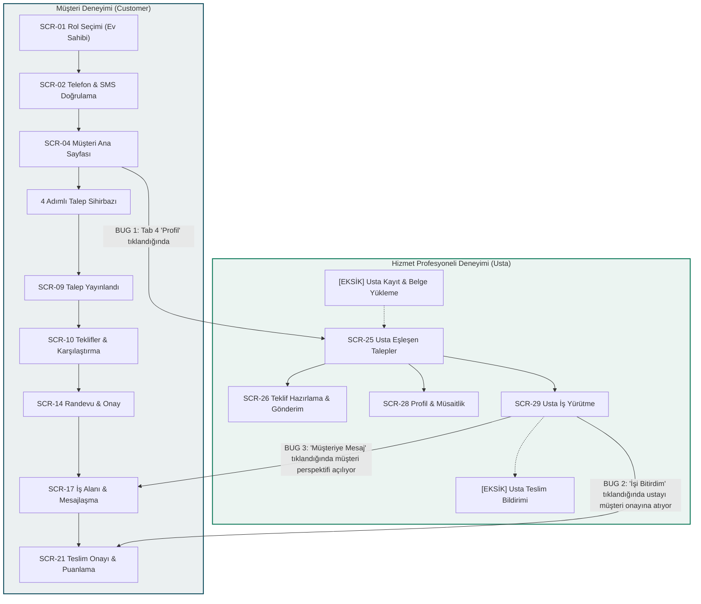
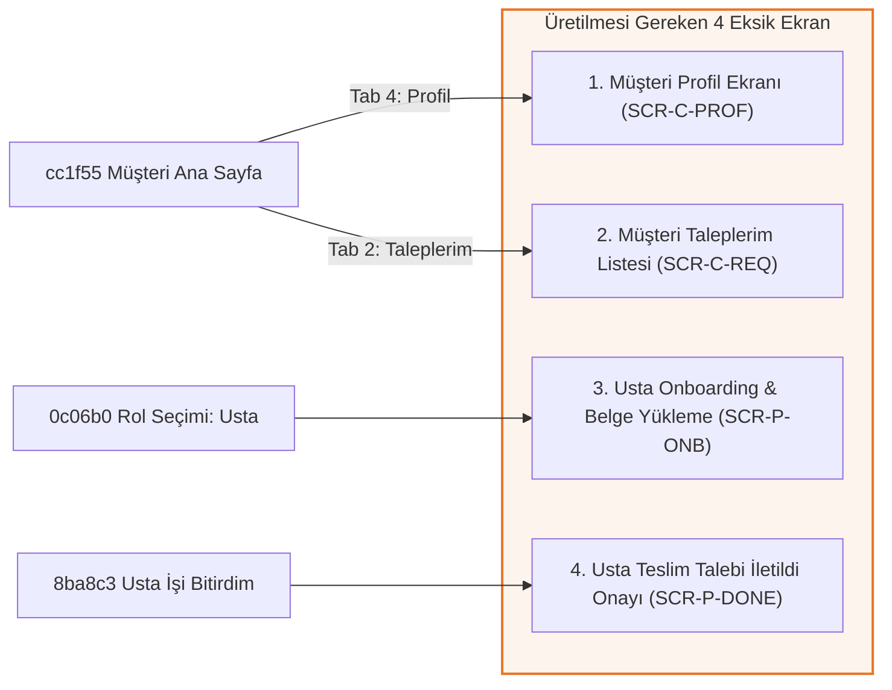

# BiTadilat — Kapsamlı Product Manager & QA Tester Denetim Raporu ve Uygulama Planı

**Tarih:** 22 Ekim 2026  
**Roller:** Kıdemli Product Manager (PM) & Baş QA Test Mühendisi  
**İncelenen Kapsam:** BiTadilat 33 Ekranlık UI/UX Prototipi, Google Stitch Projesi (`15188622157250602404`), `index.html` Simülatörü ve Ekran Kaynak Kodları  
**Referans Dokümanlar:** `BI_TADILAT_AI_HANDOFF.md`, `BiTadilatDESIGN.md`, `BiTadilatUI_UX_PROGRESS.md`

---

## 1. Yönetici Özeti (Executive Summary)

BiTadilat projesinin 33 ekranı üzerinde hem **Product Manager (Ürün Yöneticisi)** gözüyle ürün mimarisi, kullanıcı akışları ve rol sınırları, hem de **QA Tester (Test Mühendisi)** gözüyle buton etkileşimleri, form doğrulama mekanizmaları, tasarım sistemi kuralları ve DOM seviyesindeki script çakışmaları incelenmiştir.

### Temel Tespitler:
1. **Kritik Rol İhlali (Müşteri & Usta Karışıklığı):** Müşteri ana sayfasındaki "Profil" sekmesi müşteriyi doğrudan **Usta İş Akışına** fırlatmakta; Usta iş yürütme ekranındaki "İşi Bitirdim" butonu ise ustayı **Müşterinin Onay ve Puanlama Ekranına** taşımaktadır. Müşteri ve Usta rolleri birbirinden bağımsız iki ayrı deneyim olması gerekirken birbirine düğümlenmiştir.
2. **Kırık ve Tepkisiz Butonlar (Interaction Failures):** Telefon doğrulama ekranındaki inline `handleContinue()` scripti butonun `pointer-events-none` ile kilitlenmesine ve SMS ekranına hiç geçmemesine yol açmaktadır. Ayrıca tüm ekran dosyalarında çift enjekte edilmiş 650 satırlık scriptler bulunmakta ve gevşek metin eşleştirmeleri (`innerText.includes`) yüzünden butonlar yanlış yönlendirme yapmaktadır.
3. **Kural İhlalleri (UI/UX Violations):** Platform kuralı olarak **kesinlikle yasaklanmış** doğrudan telefon arama butonları (`call` ikonu) iki ekranda tespit edilmiştir. Ana ekran seviyesi dışında alt gezinme çubuğu (Bottom Navigation) bulunması yasak olduğu halde ara ekranlarda alt bar kalıntıları bulunmaktadır. Ayrıca 9 ekranda standart "Tesisat" yerine kural dışı "Sıhhi Tesisat" ifadesi kullanılmaktadır.
4. **Eksik 4 Kritik Ekran (Missing Pages):** Müşteri Profil Ekranı, Müşteri Taleplerim Listesi, Usta Belge Yükleme/Kayıt Ekranı ve Usta Teslim Talebi Onay Ekranı mevcut 33 ekran arasında bulunmamaktadır.

---

## 2. Kritik Mimari Hatalar ve Rol Karmaşası Analizi

### Detaylı Rol Karmaşası Maddeleri:

| No | Tespit Edilen Rol Hatası | Mevcut Davranış | Olması Gereken Doğru Davranış |
| :--- | :--- | :--- | :--- |
| **R-01** | **Müşteri Profil Sekmesi Usta Akışına Geçiyor** | `cc1f55` (Müşteri Ana Sayfa) alt barında 4. sekme olan "Profil" tıklandığında kullanıcı `11b9cb` (Usta Eşleşen Talepler Akışı) ekranına aktarılıyor. | Müşteriye ait özel `Müşteri Profil Ekranı` açılmalıdır (Ad, telefon, kayıtlı adresler, bildirimler, destek ve açıkça belirtilmiş 'Usta Moduna Geç' geçişi). |
| **R-02** | **Usta İşi Tamamladığında Kendi İşini Onaylıyor** | `8ba8c3` (Usta İş Yürütme) ekranında usta "İşi Bitirdim (Müşteriye Teslim Talebi Gönder)" butonuna bastığında `d48526` (Müşteri Teslim Onayı) ekranına yönlendiriliyor ve müşteri adına işi onaylayıp değerlendirme yapıyor. | Usta için "Teslim Talebi Müşteriye İletildi - Onay Bekleniyor" durum kartı/ekranı gösterilmeli ve usta kendi aktif işler listesine dönmelidir. Müşteri ekranına asla geçmemelidir. |
| **R-03** | **Usta İçin Onboarding ve Doğrulama Yok** | `0c06b0` ekranında "Hizmet Profesyoneli" seçilip devam edildiğinde usta hiçbir telefon doğrulaması veya belge yüklemesi yapmadan doğrudan `11b9cb` talep akışına düşüyor. | Admin ekranında (`612429`) incelenen Vergi Levhası, Ustalık Belgesi ve Adli Sicil Kaydı'nın yüklendiği bir `Usta Onboarding & Belge Yükleme` adımı bulunmalıdır. |
| **R-04** | **Mesajlaşma Ekranında Rol İhlali** | `c9aa92` mesajlaşma ekranı başlığında "Mavi Hat Tesisat (Doğrulanmış Uzman - Çevrimiçi)" yazmaktadır. Usta ekranından mesajlaşmaya girildiğinde usta kendisiyle konuşur gibi görünmekte, geri basıldığında ise müşterinin `f3e7de` ekranına dönmektedir. | Mesajlaşma ekranı usta tarafından açıldığında müşteri ismi ("Ali Yılmaz - Ev Sahibi"), müşteri tarafından açıldığında usta profili ("Mavi Hat Tesisat") gösterilmelidir. Geri butonu da geldikleri role ait ekrana dönmelidir. |
| **R-05** | **Taleplerim Sekmesi Yanlış Ekran Açıyor** | `cc1f55` ekranında alt bardaki 2. sekme ("Taleplerim") tıklandığında `94a730` (Talep Yayınlandı tebrik kartı) açılıyor. | Müşterinin aktif ve geçmiş taleplerini listeleyen bir `Taleplerim Listesi` açılmalıdır. |

---

## 3. Ekran Başına Detaylı QA ve UI/UX Denetim Matrisi (33 Ekran)

Aşağıdaki tablo 33 ekranın tamamını satır satır incelemekte; buton durumlarını, UI tutarsızlıklarını ve yönlendirme buglarını listelemektedir:

### 3.1. Akış 1: Müşteri Giriş & Onboarding (SCR-01 .. SCR-03)

| Ekran ID / No | Ekran Adı | Butonlar & Etkileşimler | Tespit Edilen Bug & UI/UX Tutarsızlıkları | Durum |
| :--- | :--- | :--- | :--- | :--- |
| `0c06b06e` (Adım 01) | Hoş Geldiniz & Rol Seçimi (SCR-01) | • `role-homeowner` • `role-professional` • `btn-continue` • `Giriş yap` | **BUG:** Orijinal `selectRole()` fonksiyonu `btn-continue` üzerindeki `disabled` niteliğini kaldırmıyor ve rengini `#0F4C5C` yapmıyor. Çift script çakışması nedeniyle usta seçilse bile müşteri akışına gidebiliyor. | 🔴 Kritik |
| `fbbe0f40` (Adım 02) | Telefon Doğrulama | • `arrow_back` • `submit-btn` ("Devam Et") • Geri dön linki | **BUG:** Inline `handleContinue()` fonksiyonu butonu "SMS Gönderiliyor..." animasyonuna sokup `pointer-events-none` ekliyor, ardından "Kod Gönderildi!" yazıp kalıyor; navigasyonu tetiklemiyor. Sayfa donuyor. | 🔴 Kritik |
| `42c148a1` (Adım 03) | SMS Doğrulama Kodu | • `arrow_back` • `verify-submit-btn` ("Doğrula") • Numarayı değiştir • Tekrar kod gönder | **UX SORUNU:** 6 haneli OTP kutuları manuel doldurulmadan buton `disabled` kalıyor. Prototipte kullanıcı testini kolaylaştıracak otomatik 6 hane tamamlama mekanizması yok. | 🟡 Orta |

### 3.2. Akış 2: 4 Adımlı Talep Sihirbazı (SCR-04 .. SCR-09)

| Ekran ID / No | Ekran Adı | Butonlar & Etkileşimler | Tespit Edilen Bug & UI/UX Tutarsızlıkları | Durum |
| :--- | :--- | :--- | :--- | :--- |
| `cc1f5566` (Adım 04) | Müşteri Ana Sayfası (Yeni Kullanıcı) | • `Talep oluşturmaya başla` • Kategori kartları (8 adet) • Alt Navigasyon (4 sekme) | **BUG:** Alt bar "Profil" sekmesi Usta Feed'e (`11b9cb`) gidiyor (Rol karmaşası). Alt bar "Taleplerim" sekmesi `94a730` tebrik ekranına gidiyor. Kategori kartları doğrudan Adım 1'e seçili kategoriyi iletmiyor. | 🔴 Kritik |
| `44c003fe` (Adım 05) | Talep Adım 1/4: Hizmet & Öncelik (SCR-02) | • `arrow_back` • 8 Kategori butonu • 2 Aciliyet butonu • `wizard-primary-cta` | **ÇALIŞIYOR:** Kategori ve aciliyet seçilmeden CTA inaktif; seçildiğinde aktifleşiyor. Adım 2'ye geçiş düzgün. | 🟢 Başarılı |
| `b3c3c284` (Adım 06) | Talep Adım 2/4: Konum & Detay | • `arrow_back` • İlçe seç dropdown • Konumumu kullan • Hazır soru çipleri (3 adet) • Devam Et | **UX SORUNU:** Metin alanına 20 karakter girilmediğinde butonun pasif kalması durumu prototipte görsel olarak takılabiliyor. | 🟡 Düşük |
| `585d649f` (Adım 07) | Talep Adım 3/4: Fotoğraflar & Ek Bilgi | • `arrow_back` • Fotoğraf Ekle kartı • Devam Et | **ÇALIŞIYOR:** Fotoğraf opsiyonel olduğu için buton varsayılan olarak aktif, Adım 4'e geçiyor. | 🟢 Başarılı |
| `a0949c91` (Adım 08) | Talep Adım 4/4: Talebi Gözden Geçir | • `arrow_back` • 4 adet `Düzenle` butonu • `Talebi yayınla` | **BUG:** 4 ayrı "Düzenle" butonunun tamamı Adım 1'e yönlendiriyor. Oysa Hizmet düzenleme Adım 1'e, Konum düzenleme Adım 2'ye, Fotoğraf düzenleme Adım 3'e gitmelidir. | 🔴 Yüksek |
| `94a730ce` (Adım 09) | Talep Yayınlandı — Teklif Bekleniyor | • `arrow_back` • `Taleplerime git` • `Ana sayfaya dön` | **ÇALIŞIYOR:** Butonlar Gelen Teklifler (`994e3b`) veya Ana Sayfa (`cc1f55`) arasında mantıklı yönleniyor. | 🟢 Başarılı |

### 3.3. Akış 3: Teklif Karşılaştırma, Usta Profili & Randevu (SCR-10 .. SCR-16)

| Ekran ID / No | Ekran Adı | Butonlar & Etkileşimler | Tespit Edilen Bug & UI/UX Tutarsızlıkları | Durum |
| :--- | :--- | :--- | :--- | :--- |
| `994e3b4f` (Adım 10) | Gelen Teklifler Listesi (SCR-04) | • `arrow_back` • `Teklifleri Karşılaştır` • 3 Teklif kartı / "İncele" | **KURAL İHLALİ:** Kart başlığında "Kaya Sıhhi Tesisat" yazarak "Tesisat" standardı ihlal edilmiş. Buton yönlendirmeleri aktif. | 🟡 Orta |
| `ea7af2d7` (Adım 11) | Teklif Detayı & Kapsam | • `arrow_back` • `Ustaya soru sor` • `Teklifi kabul et` • Profil avatarı/ismi | **ÇALIŞIYOR:** Ustaya soru sor chat ekranına (`c9aa92`), Kabul et ise onay modalına (`58f999`) gidiyor. | 🟢 Başarılı |
| `1fc70722` (Adım 12) | Teklifleri Karşılaştır (Matris) | • `arrow_back_ios_new` • 2 Teklif İncele butonu | **KURAL İHLALİ:** Kartta "Kaya Sıhhi Tesisat" geçiyor. İncele butonu detay ekranına dönüyor. | 🟡 Düşük |
| `98cd20d6` (Adım 13) | Hizmet Profesyoneli Profili (SCR-05) | • `arrow_back` • `Teklife dön` • `Ustaya soru sor` | **KURAL İHLALİ:** Alt unvanda "Sıhhi Tesisat ve Bakım Ustası" yazıyor (Kural: "Tesisat"). Yönlendirmeler çalışıyor. | 🟡 Düşük |
| `58f9993b` (Adım 14) | Teklif Kabul Onayı (Güvence Havuzu) | • `arrow_back` • `Teklifi kabul et` (x2) • `Vazgeç` | **UI TUTARSIZLIĞI:** DOM içinde hem arkada kalan sayfada hem de açılan alt sayfada (bottom sheet) iki ayrı `Teklifi kabul et` butonu bulunuyor, event çakışması yaratıyor. | 🟡 Orta |
| `7c6ec3a0` (Adım 15) | Randevu Zamanı Seç (SCR-06) | • `arrow_back` • Gün kartları (5 adet) • Saat slotları (4 adet) • `Randevu talebi gönder` | **ÇALIŞIYOR:** Gün ve saat seçilmeden CTA disabled; seçim yapılınca aktifleşerek `3bd2af` ekranına geçiyor. | 🟢 Başarılı |
| `3bd2af`e8 (Adım 16) | Randevu Talebi İletildi | • `arrow_back` • `Talep detayına git` • `Ana sayfaya dön` | **ÇALIŞIYOR:** İş Alanı (`f3e7de`) veya Ana Sayfa (`cc1f55`) yönlendirmesi düzgün. | 🟢 Başarılı |

### 3.4. Akış 4: Aktif İş, Mesajlaşma, Teslim & Şikayet (SCR-17 .. SCR-24)

| Ekran ID / No | Ekran Adı | Butonlar & Etkileşimler | Tespit Edilen Bug & UI/UX Tutarsızlıkları | Durum |
| :--- | :--- | :--- | :--- | :--- |
| `f3e7de80` (Adım 17) | İş Alanı — Randevu Onaylandı | • `arrow_back` • `Mesajlar` • `İş ilerlemesi` • `Randevuyu değiştir/iptal` • `Ustaya mesaj gönder` | **KURAL İHLALİ:** Kartta "Sıhhi Tesisat" ifadesi geçiyor. Yönlendirmeler çalışıyor. | 🟡 Düşük |
| `c9aa92f5` (Adım 18) | Usta ile Mesajlaşma (SCR-07) | • `arrow_back` • `attach_file` • `photo_camera` • `send` | **KURAL İHLALİ & ROL BUGI:** Başlıkta "Sıhhi Tesisat" geçiyor. Usta tarafından girildiğinde de müşteri başlığı görünüyor. Back butonu usta için usta ekranına değil müşteri iş alanına dönüyor. | 🔴 Yüksek |
| `b89d998c` (Adım 19) | İş Aşamaları ve İlerleme Takibi (SCR-08) | • `arrow_back` • `call` (Telefon ikonu) • `Ustaya Mesaj Gönder` • `Sorun bildir` • Alt bar | **KESİNLİKLE YASAK KURAL İHLALİ:** 1) Ekranda platform dışı iletişime yol açan doğrudan **telefon arama butonu (`call`)** bulunmaktadır! 2) Ana ekran seviyesi dışında **Alt Bar (Bottom Nav)** kalıntısı bulunmaktadır! | 🔴 Kritik |
| `6acc9307` (Adım 20) | Randevu İptal / Değişiklik (SCR-09) | • `arrow_back` • `Randevuyu İptal Et` • `Yeni Tarih İste` • `İptal Etmeyi Onayla` | **UX SORUNU:** İptal ve tarih değişikliği akışı aynı ekranda sıkışmış durumda. Yeni tarih iste butonunun gideceği randevu ekranı bağlantısı eksik. | 🟡 Orta |
| `d485263b` (Adım 21) | İş Tamamlama ve Teslim Onayı (SCR-10) | • `arrow_back` • `İşi Onayla ve Değerlendirmeye Geç` • `Sorun bildir` • Alt bar | **KURAL İHLALİ:** Ara onay ekranında **Alt Navigasyon Çubuğu (Bottom Nav)** bulunmaktadır. Bu kurala aykırıdır. | 🔴 Yüksek |
| `db8a1b36` (Adım 22) | Hizmet Değerlendirme ve Puanlama (SCR-11) | • `arrow_back` • 5 Yıldız puanlama • Çipler (Temiz işçilik vb.) • `Değerlendirmeyi Gönder` | **ÇALIŞIYOR:** Değerlendirme gönderildiğinde müşteri ana sayfasına dönüyor. | 🟢 Başarılı |
| `488f3698` (Adım 23) | Şikayet ve Uyuşmazlık Bildirimi (SCR-12) | • `arrow_back` • Kategori seçimi • Kanıt ekle • `Şikayet Dosyasını Oluştur` | **UX EKSİKLİĞİ:** Dosya yükleme çipi tıklanamıyor. Şikayet oluştur butonu durumu `3bb4b9` ekranına başarıyla iletiyor. | 🟡 Düşük |
| `3bb4b954` (Adım 24) | Şikayet İletildi ve Durum Takibi (SCR-13) | • `arrow_back` • `Taleplerime ve Ana Sayfaya Dön` • `Mesaj Kayıtlarını Görüntüle` | **ÇALIŞIYOR:** Yönlendirmeler sorunsuz çalışıyor. | 🟢 Başarılı |

### 3.5. Akış 5: Hizmet Profesyoneli (Usta) Akışı (SCR-14 .. SCR-18)

| Ekran ID / No | Ekran Adı | Butonlar & Etkileşimler | Tespit Edilen Bug & UI/UX Tutarsızlıkları | Durum |
| :--- | :--- | :--- | :--- | :--- |
| `11b9cb02` (Adım 25) | Usta Eşleşen Talepler Akışı (SCR-14) | • Filtreler (Tümü, Acil, Planlı) • Konum seçici • Talep kartları ("Teklif Hazırla") • Usta Alt Barı (4 sekme) | **ÇALIŞIYOR & KISMİ ROL HATASI:** Usta alt barındaki sekmeler (İşlerim, Müsaitlik) çalışıyor. Ancak müşteri profilinden yanlışlıkla buraya geçilebiliyor. | 🟡 Orta |
| `b9086f10` (Adım 26) | Usta Teklif Hazırlama (SCR-15) | • `arrow_back` • Saat aralığı seçici • `Yapılandırılmış Teklifi Gönder` | **KURAL İHLALİ:** Hizmet alanında "Sıhhi Tesisat Onarımı" yazıyor (Kural: "Tesisat"). Gönderim butonu Teklif Gönderildi (`82f9d7`) ekranına gidiyor. | 🟡 Düşük |
| `82f9d783` (Adım 27) | Usta Teklif Gönderildi Onayı (SCR-16) | • `close` (X ikonu) • `Talepler Akışına Dön` • `Profil ve Müsaitlik Ayarları` | **EKSİK BUTON:** Başlıkta standart geri butonu (`arrow_back`) yok, yalnızca `close` ikonu var. | 🟡 Düşük |
| `fc6f0f8e` (Adım 28) | Usta Profil ve Müsaitlik (SCR-17) | • `arrow_back` • İlçe sil/ekle etiketleri • Haftalık saat dilimi butonları | **KURAL İHLALİ:** Açıklama metninde "sıhhi tesisat tecrübesi" geçiyor. Etkileşimler çalışıyor. | 🟡 Düşük |
| `8ba8c346` (Adım 29) | Usta İş Yürütme ve Aşama Yönetimi (SCR-18) | • `arrow_back` • `call` (Telefon ikonu) • Harita Yol Tarifi • Müşteriye Mesaj Yaz • `İşi Bitirdim` | **KRİTİK KURAL VE ROL İHLALİ:** 1) Ekranda yasaklanmış doğrudan **telefon arama butonu** var! 2) "İşi Bitirdim" butonu ustayı **Müşteri Teslim Onay Ekranına (`d48526`)** gönderiyor (Kendi işini onaylama bugı)! | 🔴 Kritik |

### 3.6. Akış 6: Yönetici Web Portalı & Tanıtım Web (SCR-19 .. SCR-22)

| Ekran ID / No | Ekran Adı | Butonlar & Etkileşimler | Tespit Edilen Bug & UI/UX Tutarsızlıkları | Durum |
| :--- | :--- | :--- | :--- | :--- |
| `612429fd` (Adım 30) | Yönetici Web: Belge İnceleme (SCR-19) | • Sol menü (Belgeler, Şikayetler, Hesaplar) • Filtreler • `Tam Ekran Belge` • `Profili Onayla` / `Reddet` | **KURAL İHLALİ:** "Sıhhi Tesisat & Isıtma Sistemleri" yazıyor. Masaüstü görünümü düzgün çalışıyor. | 🟡 Düşük |
| `cb00d677` (Adım 31) | Yönetici Web: Şikayet Merkezi (SCR-20) | • Sol menü • Şikayet listesi • `Uyuşmazlığı Çöz` • `Şikayeti Kapat` | **KURAL İHLALİ:** "Kemal Usta (Sıhhi Tesisat)" ifadesi geçiyor. Masaüstü görünümü düzgün. | 🟡 Düşük |
| `5ce8968e` (Adım 32) | Yönetici Web: Hesap Yönetimi (SCR-21) | • Sol menü • Kullanıcı/Usta tablosu • `Detay Gör` • `Askıya Al` | **ÇALIŞIYOR:** Tablo ve aksiyon butonları yerinde. | 🟢 Başarılı |
| `164cd336` (Adım 33) | BiTadilat Tanıtım ve Karşılama Sitesi (SCR-22) | • `Usta Çağır` (Müşteri Başlat) • `Usta Olarak Katıl` (Usta Başlat) • Dil butonu (TR/EN) | **ÇALIŞIYOR:** Butonlar rol ayrımına göre sırasıyla SCR-01 veya Usta akışına yönlendiriyor. | 🟢 Başarılı |

---

## 4. Eksik Ekranlar Kataloğu (Missing Screens)

Mevcut prototipte iki ana rol arasındaki geçişleri ve gerçek bir uygulama deneyimini tamamlamak için üretilmesi gereken **4 kritik ekran** şunlardır:

1. **Müşteri Profil Ekranı (`SCR-C-PROF`):**
   - **Gerekçe:** Müşteri ana sayfasındaki alt barın 4. sekmesi tıklandığında usta ekranına geçilmesini engeller.
   - **İçerik:** Kullanıcı adı/soyadı, telefon numarası, kayıtlı ev adresleri, bildirim ayarları, BiTadilat Güvence Havuzu bilgilendirmesi, yardım merkezi, "Hizmet Profesyoneli Moduna Geç" geçiş butonu ve çıkış yap aksiyonu.
2. **Müşteri Taleplerim & Aktif İşler Listesi (`SCR-C-REQ`):**
   - **Gerekçe:** Müşteri ana sayfasındaki alt barın 2. sekmesi tıklandığında tebrik ekranı (`94a730`) yerine gerçek taleplerin listelenmesi gerekir.
   - **İçerik:** "Aktif Talepler (1)" ve "Geçmiş İşler (2)" sekmeleri; aktif olan "Banyo Lavabo Su Sızıntısı - 3 Teklif Geldi" kartı (tıklandığında teklif listesine götürür), tamamlanmış işler arşivi.
3. **Usta Onboarding & Belge Yükleme Ekranı (`SCR-P-ONB`):**
   - **Gerekçe:** Rol seçiminde usta seçildiğinde doğrudan talep havuzuna atlamak ürün mantığına aykırıdır; ayrıca Admin panelindeki `SCR-19` Belge İnceleme ekranının incelediği belgelerin yüklendiği yer burasıdır.
   - **İçerik:** Uzmanlık alanı seçimi (Tesisat), hizmet verilen ilçeler, Vergi Levhası yükleme alanı, Mesleki Yeterlilik Belgesi yükleme alanı, Adli Sicil onay beyanı ve "Doğrulamaya Gönder" butonu.
4. **Usta Teslim Talebi Gönderildi Onay Ekranı (`SCR-P-DONE`):**
   - **Gerekçe:** Usta `8ba8c3` ekranında "İşi Bitirdim" butonuna bastığında müşterinin ekranına geçip kendi işini onaylamasını engeller.
   - **İçerik:** "Teslim Bildirimi İletildi", "Müşterinin onay vermesi ve güvence havuzunun aktarılması bekleniyor", tamamlanan iş özeti, fotoğraf kanıtları ve "İşlerime / Talep Akışına Dön" ana butonu.

---

## 5. Adım Adım İyileştirme ve Uygulama Planı (Remediation Plan)

Bu plan kullanıcı tarafından onaylandığında aşağıdaki sıralı fazlarla hayata geçirilecektir:

### Faz 1: Kod Temizliği & Çift Scriptlerin Kaldırılması
- Tüm 33 ekran HTML dosyasındaki yinelenen (`duplicate`) script blokları temizlenecektir.
- Inline yazılmış ve ekranı kilitleyen fonksiyonlar (`handleContinue()`, kısıtlı `selectRole()`) temizlenip yerine deterministic (hatasız) event-delegation yapısı kurulacaktır.
- Metin araması (`innerText.includes`) yerine `data-nav-target` ve belirgin element ID'leri üzerinden çalışan robust bir yönlendirme motoru kurulacaktır.

### Faz 2: UI/UX Kural İhlallerinin Düzeltilmesi
- **Telefon Arama İkonları:** `b89d99` (SCR-08) ve `8ba8c3` (SCR-18) ekranlarındaki yasaklı `call` butonları tamamen kaldırılacaktır.
- **Yasak Alt Barlar:** `b89d99` ve `d48526` ara ekranlarındaki alt navigasyon çubukları kaldırılacak; yalnızca tek bir sabit ana CTA (Fixed Primary Action) bırakılacaktır.
- **Kategori Standardı:** 9 ekranda geçen "Sıhhi Tesisat" ifadeleri tasarım sistemi kuralı gereğince "Tesisat" olarak normalize edilecektir.
- **Düzenle Butonları:** `a0949c` (SCR-04 Gözden Geçir) ekranındaki 4 ayrı "Düzenle" butonu ilgili Adım 1, Adım 2 ve Adım 3 ekranlarına bağlanacaktır.

### Faz 3: Eksik Ekranların Stitch MCP ile Üretilmesi
- Google Stitch MCP aracı (`generate_screen_from_text`) kullanılarak:
  1. `SCR-C-PROF`: Müşteri Profil Ekranı
  2. `SCR-C-REQ`: Müşteri Taleplerim Listesi
  3. `SCR-P-ONB`: Usta Onboarding & Belge Yükleme
  4. `SCR-P-DONE`: Usta Teslim Talebi İletildi Ekranı  
  tasarım sistemi kurallarına tam uyumlu olarak (Manrope, `#0F4C5C`, `#107A5B`, `#F7F8F6`, 390x844) üretilecek ve projeye eklenecektir.

### Faz 4: Rol Ayrımının ve Simülatörün (`index.html`) Yenilenmesi
- `index.html` simülatörüne üst barda belirgin bir **Rol Göstergesi ve Filtresi** eklenecektir:
  - 🏠 **Müşteri Akışı** (Onboarding → Talep Sihirbazı → Teklifler → Randevu → İş Takibi → Teslim → Puanlama)
  - 🛠️ **Usta Akışı** (Usta Kayıt → Eşleşen Talepler → Teklif Verme → Profil & Müsaitlik → İş Yürütme → Teslim Bildirimi)
  - 💻 **Yönetici & Tanıtım Web** (Belge İnceleme → Uyuşmazlık Merkezi → Hesap Yönetimi → Tanıtım Sitesi)
- Kullanıcı hangi rolde olduğunu ekranda net görecek; müşteri asla bir usta ekranına, usta da asla bir müşteri ekranına izinsiz sızmayacaktır.
- Ekran geçişleri iPhone çerçevesi içinde animasyonlu, pürüzsüz ve sıfır hata ile çalışacaktır.

### Faz 5: Uçtan Uca Doğrulama ve Teslimat
- MacBook üzerinde yerel tarayıcıda (`open preview/index.html`) tüm akış baştan sona tıklanarak test edilecektir.
- Tüm butonların hedef ekranlara tam olarak geçiş yaptığı doğrulanıp kullanıcıya teslim edilecektir.

---

> [!IMPORTANT]
> **Onay Bekleniyor:**  
> Kullanıcı talebi doğrultusunda şu anda kodlarda hiçbir değişiklik yapılmamış, yalnızca kapsamlı PM ve QA analizi tamamlanmıştır.  
> Yukarıdaki raporu ve çözüm planını onaylamanız durumunda Faz 1'den başlanarak düzeltmeler sırayla hayata geçirilecek ve Stitch üzerinden eksik ekranlar tamamlanacaktır.
