# BiTadilat — Yazılım Tasarım Belgesi (SDD)

| | |
|---|---|
| Proje | BiTadilat (COMP/SOFT4902 Bitirme Projesi, Güz 2026) |
| Belge | Yazılım Tasarım Belgesi (System Design Document) |
| Durum | Taslak. Kod `feature/flutter-app` dalındaki 565bfb4 işlemine göre yazıldı |
| Kaynaklar | `BiTadilat_Requirements_Analysis_Document.md` (RAD v1.1), `docs/spec/*`, `backend/`, `apps/*`, `packages/*` |
| Dil | Türkçe. Kod, tablo ve alan adları İngilizce kalır |

Bu belge **gerçekleştirilmiş sistemi** anlatır. RAD'daki bir şey yapılmadıysa "gerçekleştirilmedi" yazılıdır. RAD'dan bilinçli ayrılmalar 11. bölümde toplanmıştır.

---

## 1. Amaç ve kapsam

BiTadilat, İstanbul'da ev tadilat ve onarım işi isteyen müşterileri uygun ustalarla buluşturan bir pazaryeridir. Müşteri talep açar, kurallara göre eşleşen ustalar yapılandırılmış teklif verir, müşteri bir teklifi kabul edip parayı kartla yatırır. Para, iş onaylanana kadar bir emanet (güvence) defterinde tutulur. Anlaşmazlıkta yönetici karar verir.

**Kapsamdaki parçalar**

| Parça | Teknoloji | Konum |
|---|---|---|
| Mobil uygulama (müşteri ve usta, tek hesap iki mod) | Flutter, iOS öncelikli | `apps/mobile` |
| Yönetim paneli | Flutter Web | `apps/admin` |
| Ortak API istemcisi ve modeller | Dart paketi | `packages/bitadilat_api` |
| Ortak tasarım bileşenleri | Dart paketi | `packages/bitadilat_ui` |
| Sunucu | Spring Boot 4.1.2, Java 21, Spring Security (JWT), Flyway | `backend` |
| Veritabanı | PostgreSQL 16 | `backend/src/main/resources/db/migration` |
| Ödeme sağlayıcısı | Craftgate **sandbox** (3D Secure) | dış hizmet |

**Kapsam dışı / gerçekleştirilmedi**

- Tanıtım web sitesi (RAD UC14): yapılmadı.
- Push bildirimi (FCM/APNs): yapılmadı. `device_tokens` tablosu ve `PUT /api/v1/devices` var, gönderen servis yok. Uygulama içi bildirim merkezi var.
- Gerçek e-posta/SMS: şifre sıfırlama kodu `LoggingEmailSender` ile yalnızca log'a yazılır.
- Docker ile paketleme: repoda Dockerfile yok.
- Android: proje iskeleti var, derlenip sınanmadı.
- Gerçek para: Craftgate yalnızca sandbox. Usta ödemesi (payout) bankaya gönderilmez, `payout_ledger` ve `escrow_payment` satırlarında **kaydedilir**.

---

## 2. Mimari

### 2.1 Bileşen diyagramı

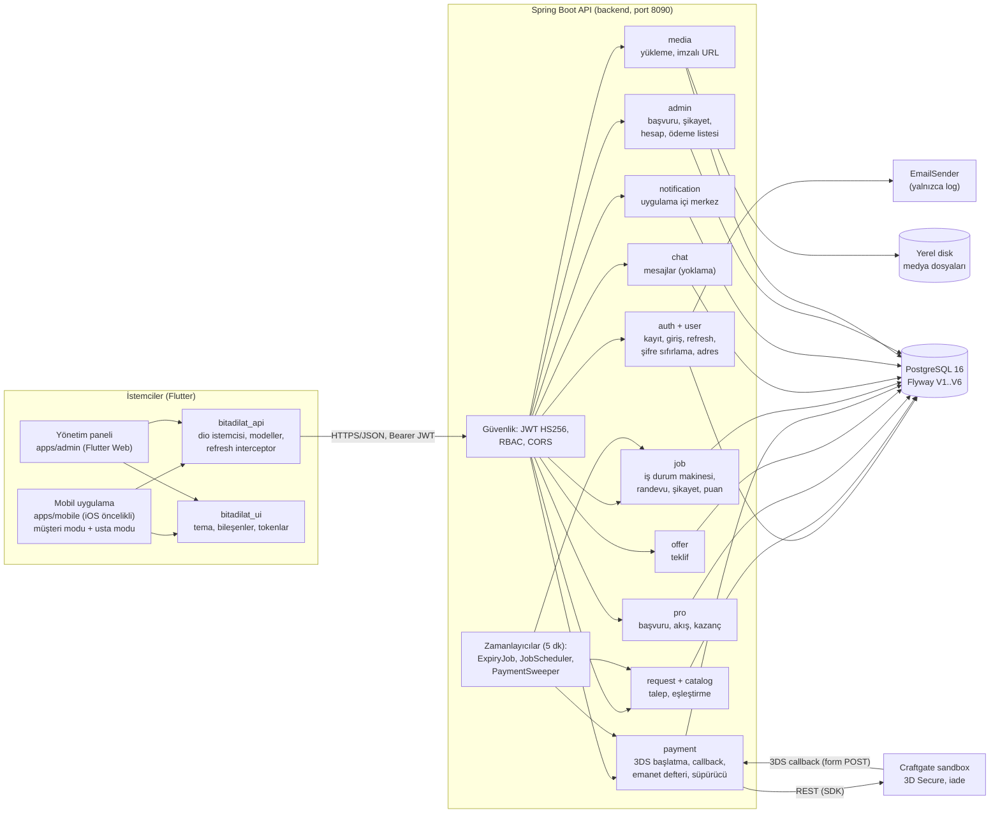

Katmanlama kuralları (kodda uygulanan):

- İstemci sunucuyla yalnızca REST/JSON ile konuşur (RAD: ayrık mimari). Sözleşme `docs/spec/API_V1.md`. Hata gövdesi `{ "error": { "code", "message", ... } }` biçimindedir.
- İş kuralları sunucudadır. İstemci "hangi düğme görünür" bilgisini sunucunun döndüğü `actions` listesinden alır (`JobStateMachine.allowedActions`). Kural ve ekran ayrışamaz.
- `PaymentGateway` arayüzü Craftgate SDK'yı arkasına saklar. Servis katmanı SDK tiplerini görmez; testler sahte ağ geçidiyle çalışır.
- Şema Flyway ile yönetilir, `ddl-auto=validate`. Testler her bağlamda şemayı baştan kurar.

### 2.2 Dağıtım diyagramı

Gerçekleştirilen dağıtım **geliştirme ve sandbox** düzenidir. Üretim ortamı ve Docker yoktur.

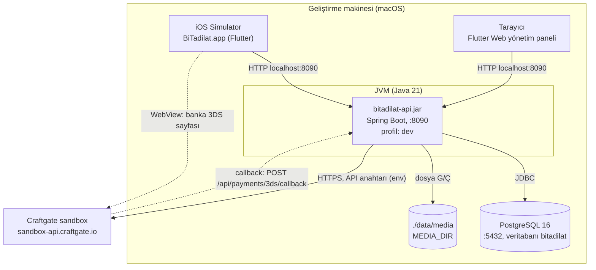

Çalışma ortamı notları:

- `dev` profili yalnızca loopback adresine bağlanır (`BITADILAT_BIND`, varsayılan 127.0.0.1) ve tohum veri ile `POST /api/v1/dev/reset` uç noktasını açar. `prod` profilinde bu bean'ler yoktur, OpenAPI/Swagger kapalıdır, gizli anahtarlar için varsayılan değer yoktur (`ProdProfileConfigTest`).
- Gerekli ortam değişkenleri: `DB_URL`, `DB_USER`, `DB_PASSWORD`, `JWT_SECRET` (en az 32 bayt), `ADDRESS_KEY` (base64, 32 bayt), `MEDIA_SIGNING_KEY` (en az 32 bayt), `MEDIA_DIR`, `CRAFTGATE_*` anahtarları, `APP_PUBLIC_BASE_URL` (3DS callback adresi için), `CORS_ALLOWED_ORIGINS`.
- 3DS callback adresi bankanın tarayıcısından erişilebilir olmalıdır (`APP_PUBLIC_BASE_URL`). Yerelde bu, Simulator için `localhost` ile çalışır; gerçek cihaz için dışarıdan erişilebilir bir adres gerekir (gerçekleştirilmedi).
- Yönetim paneli statik Flutter Web çıktısıdır (`apps/admin/web`). Ayrı bir barındırma yapılandırması yoktur; geliştirmede `flutter run -d chrome`.

### 2.3 Paket yapısı

```
backend/src/main/java/com/bitadilat/
  auth/  user/  catalog/  request/  pro/  offer/  job/  chat/  media/
  notification/  admin/  payment/{controller,service,domain,gateway,dto,config}
  common/{security,...}  dev/
apps/mobile/lib/{app,core,l10n,features/{auth,customer,pro,jobs,chat,payment,notifications,settings,shell,common}}
apps/admin/lib/{app,core,l10n,features/{auth,dashboard,applications,complaints,accounts,payments,shell,common}}
packages/bitadilat_api/lib/src/{api,core,models,...}      (freezed + json_serializable)
packages/bitadilat_ui/lib/src/{theme,tokens,typography,app_button,...}
```

İstemci durum yönetimi: Riverpod. Yönlendirme: go_router (rota korumaları `router_guards_test.dart` ile sınanır). Yerelleştirme: `gen-l10n` ARB dosyaları (TR/EN, canlı geçiş).

---

## 3. Kullanım durumu diyagramı

RAD'daki UC01–UC14, gerçekleştirilen duruma göre güncellendi. `EK` ile başlayanlar RAD'da olmayıp sonradan eklenenlerdir.

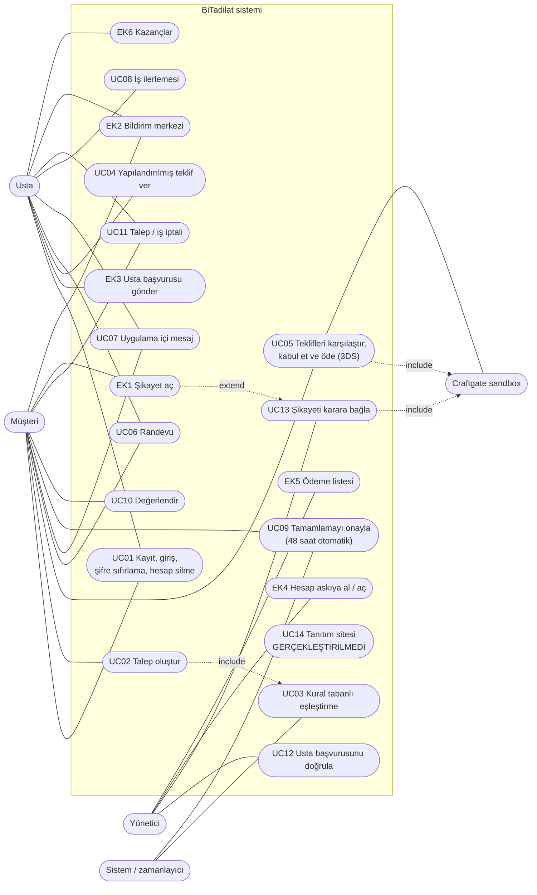

| UC | Gerçekleşen davranış | Durum |
|---|---|---|
| UC01 | E-posta **veya** telefon + şifre, KVKK/koşul onayı, şifre sıfırlama (e-posta kodu), hesap silme (anonimleştirme), müşteri/usta mod geçişi | Yapıldı (RAD'dan değişti) |
| UC02 | 4 adımlı sihirbaz, en fazla 5 fotoğraf, ilçe, acil/planlı | Yapıldı |
| UC03 | Kategori + ilçe + müsaitlik + onay durumu; eşleşme nedenleri (`matchFactors`); sıfır eşleşmede talep yine yayımlanır | Yapıldı |
| UC04 | Emek + malzeme kalemleri, varış aralığı, garanti, not; `Idempotency-Key` | Yapıldı |
| UC05 | Karşılaştırma, kabul = kart ile 3DS ödeme; başarılı callback teklifi kabul eder, diğerlerini `SUPERSEDED` yapar, işi açar | Yapıldı (genişledi) |
| UC06 | Usta onaylar ya da yeni aralık önerir; karşı taraf kabul eder | Yapıldı (değişti) |
| UC07 | İş başına sohbet, fotoğraf, okundu bilgisi; **yoklama** (websocket yok); iş kapandıktan 30 gün sonra salt okunur | Yapıldı |
| UC08 | Adrese ulaştım, başladım, bitirdim, not/fotoğraf | Yapıldı (değişti) |
| UC09 | Müşteri onayı ya da 48 saat sonra otomatik; emanet ustaya serbest bırakılır | Yapıldı (genişledi) |
| UC10 | Yalnızca `COMPLETED` iş, bir kez, 1–5 yıldız | Yapıldı |
| UC11 | Yalnızca iş başlamadan (`AWAITING_APPOINTMENT`, `SCHEDULED`, `ARRIVED`), tam iade | Yapıldı (değişti) |
| UC12 | Başvuru onayla / reddet / belge iste | Yapıldı |
| UC13 | Tam iade, %50/%50, ustaya aktar; uyarı ve askıya alma | Yapıldı (genişledi) |
| UC14 | — | **Gerçekleştirilmedi** |

---

## 4. Alan modeli (sınıf diyagramı)

Ana varlıklar ve aralarındaki ilişkiler. Alan adları veritabanı sütunlarının camelCase karşılığıdır. Tam sütun listesi 5. bölümdeki ER diyagramlarındadır.

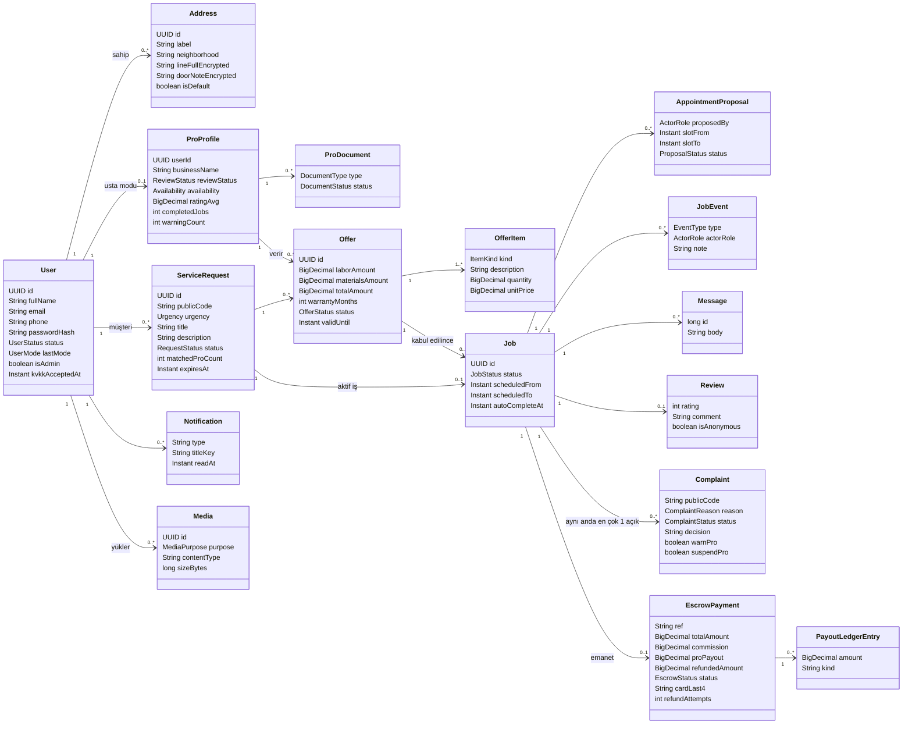

Notlar:

- `EscrowPayment.offer_id` bir **yabancı anahtar değildir** (V1'den gelen düz `varchar`). `request_id`, `customer_id`, `pro_id`, `job_id` V5 ile yabancı anahtar oldu. `payout_ledger.payment_ref` de yabancı anahtar değildir.
- `job_events.type` değerleri: `STATUS_CHANGED`, `NOTE`, `PHOTO`, `APPOINTMENT_PROPOSED`, `APPOINTMENT_ACCEPTED`.
- Teklif tutarı kuralı veritabanında zorunludur: `total_amount = labor_amount + materials_amount`.

---

## 5. Veri tabanı (ER diyagramları)

Aşağıdaki diyagramlar **Flyway V1–V6 betiklerinin boş bir PostgreSQL veritabanına uygulanması** ve `information_schema` sorgulanması ile üretilmiştir (31 tablo). Anahtar işaretleri: `PK` birincil, `FK` yabancı, `UK` benzersiz sütun. Kısmi benzersiz indeksler ve CHECK kısıtları diyagramda görünmez, 5.6'da özetlenmiştir. Diyagramlar okunabilirlik için 5 gruba bölünmüştür; bazı tablolar (ör. `users`) birden fazla grupta tekrar eder.

### 5.1 Kimlik, adres, medya, yönetim

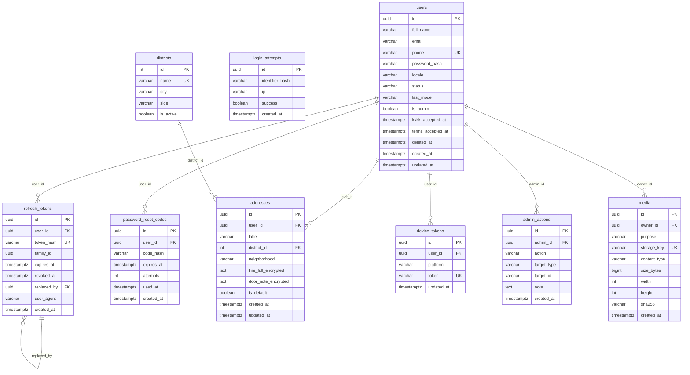

### 5.2 Usta profili

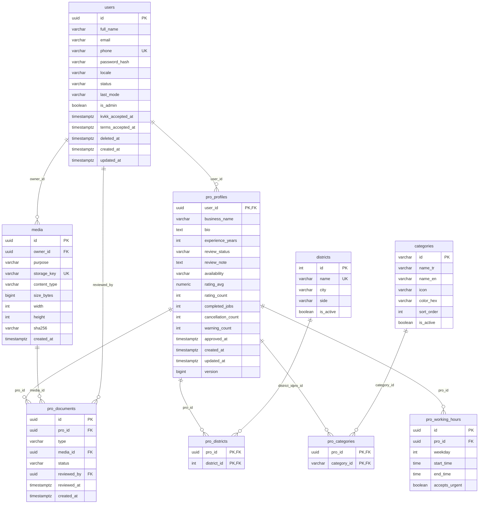


### 5.3 Talep ve teklif

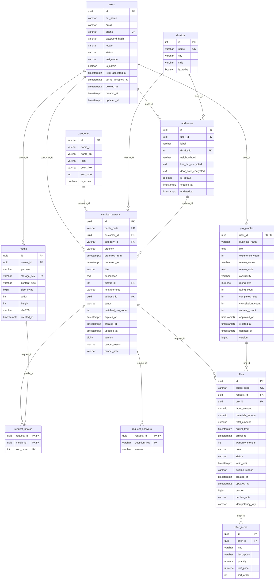

### 5.4 İş, randevu, sohbet, değerlendirme, şikayet

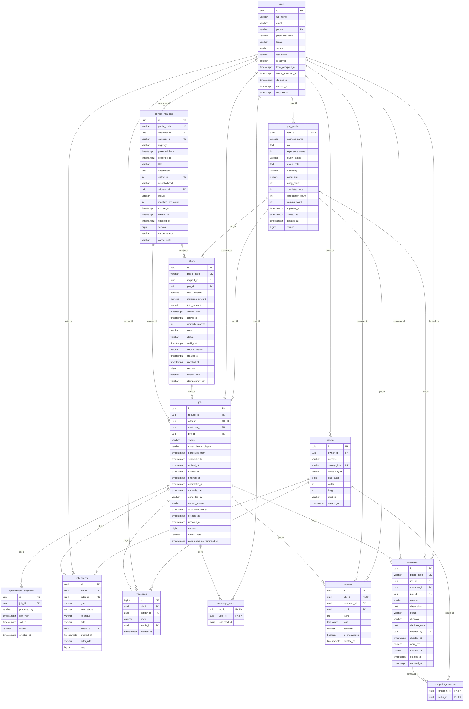

### 5.5 Emanet, defter, bildirim

```mermaid
erDiagram
    escrow_payment {
        varchar ref PK
        varchar offer_id
        varchar job_ref
        varchar attempt_key UK
        varchar conversation_id UK
        bigint craftgate_payment_id UK
        numeric total_amount
        numeric commission
        numeric pro_payout
        numeric refunded_amount
        varchar status
        varchar card_last4
        varchar error_message
        boolean result_uncertain
        timestamptz created_at
        timestamptz locked_at
        timestamptz released_at
        timestamptz refunded_at
        bigint version
        uuid request_id FK
        uuid customer_id FK
        uuid pro_id FK
        uuid job_id FK
        varchar channel
        varchar provider
        varchar error_code
        int refund_attempts
        timestamptz last_refund_attempt_at
        timestamptz next_refund_attempt_at
    }
    payout_ledger {
        uuid id PK
        varchar payment_ref
        uuid pro_id FK
        numeric amount
        varchar kind
        timestamptz created_at
    }
    notifications {
        uuid id PK
        uuid user_id FK
        varchar type
        varchar title_key
        varchar body_key
        jsonb params
        varchar target_route
        timestamptz read_at
        timestamptz created_at
    }
    jobs {
        uuid id PK
        uuid request_id FK
        uuid offer_id FK,UK
        uuid customer_id FK
        uuid pro_id FK
        varchar status
        varchar status_before_dispute
        timestamptz scheduled_from
        timestamptz scheduled_to
        timestamptz arrived_at
        timestamptz started_at
        timestamptz finished_at
        timestamptz completed_at
        timestamptz cancelled_at
        varchar cancelled_by
        varchar cancel_reason
        timestamptz auto_complete_at
        timestamptz created_at
        timestamptz updated_at
        bigint version
        varchar cancel_note
        timestamptz auto_complete_reminded_at
    }
    offers {
        uuid id PK
        varchar public_code UK
        uuid request_id FK
        uuid pro_id FK
        numeric labor_amount
        numeric materials_amount
        numeric total_amount
        timestamptz arrival_from
        timestamptz arrival_to
        int warranty_months
        varchar note
        varchar status
        timestamptz valid_until
        varchar decline_reason
        timestamptz created_at
        timestamptz updated_at
        bigint version
        varchar decline_note
        varchar idempotency_key
    }
    service_requests {
        uuid id PK
        varchar public_code UK
        uuid customer_id FK
        varchar category_id FK
        varchar urgency
        timestamptz preferred_from
        timestamptz preferred_to
        varchar title
        text description
        int district_id FK
        varchar neighborhood
        uuid address_id FK
        varchar status
        int matched_pro_count
        timestamptz expires_at
        timestamptz created_at
        timestamptz updated_at
        bigint version
        varchar cancel_reason
        varchar cancel_note
    }
    users {
        uuid id PK
        varchar full_name
        varchar email
        varchar phone UK
        varchar password_hash
        varchar locale
        varchar status
        varchar last_mode
        boolean is_admin
        timestamptz kvkk_accepted_at
        timestamptz terms_accepted_at
        timestamptz deleted_at
        timestamptz created_at
        timestamptz updated_at
    }
    pro_profiles {
        uuid user_id PK,FK
        varchar business_name
        text bio
        int experience_years
        varchar review_status
        text review_note
        varchar availability
        numeric rating_avg
        int rating_count
        int completed_jobs
        int cancellation_count
        int warning_count
        timestamptz approved_at
        timestamptz created_at
        timestamptz updated_at
        bigint version
    }
    users ||--o{ pro_profiles : "user_id"
    service_requests ||--o{ escrow_payment : "request_id"
    users ||--o{ service_requests : "customer_id"
    users ||--o{ escrow_payment : "customer_id"
    users ||--o{ escrow_payment : "pro_id"
    service_requests ||--o{ offers : "request_id"
    pro_profiles ||--o{ offers : "pro_id"
    service_requests ||--o{ jobs : "request_id"
    offers ||--o{ jobs : "offer_id"
    users ||--o{ jobs : "customer_id"
    pro_profiles ||--o{ jobs : "pro_id"
    jobs ||--o{ escrow_payment : "job_id"
    pro_profiles ||--o{ payout_ledger : "pro_id"
    users ||--o{ notifications : "user_id"
```

### 5.6 Kısmi benzersiz indeksler ve CHECK kısıtları (önemli olanlar)

Bu kurallar iş kuralını **veritabanı düzeyinde** de zorunlu kılar.

| Kural | Mekanizma |
|---|---|
| Bir usta aynı talebe tek `PENDING` teklif verir | `ux_offers_one_pending_per_pro (request_id, pro_id) WHERE status='PENDING'` |
| Aynı `Idempotency-Key` tek teklif üretir | `ux_offers_idempotency (pro_id, idempotency_key)` |
| Bir talepte tek aktif iş | `ux_jobs_one_active_per_request (request_id) WHERE status <> 'CANCELLED'` |
| Bir teklif en çok bir işe dönüşür | `jobs.offer_id UNIQUE` |
| Talep başına aynı anda tek `INITIALIZED` ödeme | `ux_escrow_one_initialized_per_request` |
| Bir işin tek emaneti | `ux_escrow_job (job_id) WHERE job_id IS NOT NULL` |
| Aynı ödeme denemesi iki kez başlamaz | `escrow_payment.attempt_key UNIQUE` |
| Bir işte en çok bir açık şikayet | `ux_complaints_one_open_per_job WHERE status IN ('OPEN','IN_REVIEW')` |
| Bir işte en çok bir bekleyen randevu önerisi | `ux_appointment_one_pending` |
| Bir iş için tek puan | `reviews.job_id UNIQUE` |
| Bir medya dosyası en çok bir kayda bağlanır | `ux_request_photos_media`, `ux_pro_documents_media`, `ux_job_events_media`, `ux_messages_media`, `ux_complaint_evidence_media` |
| Kullanıcı başına tek varsayılan adres | `ux_addresses_one_default` |
| E-posta büyük/küçük harf duyarsız benzersiz | `ux_users_email_lower (lower(email))` |
| Talep en çok 5 fotoğraf | `request_photos.sort_order BETWEEN 0 AND 4` |
| Fotoğraf ≤ 1,5 MB, belge ≤ 5 MB | `media.size_bytes` CHECK |
| Teklif tutarı = emek + malzeme, her ikisi pozitif | `offers` CHECK |
| Durum alanları geçerli değerlerle sınırlı | Tüm `status`, `kind`, `purpose` sütunlarında CHECK |

---

## 6. Dinamik modeller (sıra diyagramları)

### 6.1 Kayıt / giriş ve token yenileme

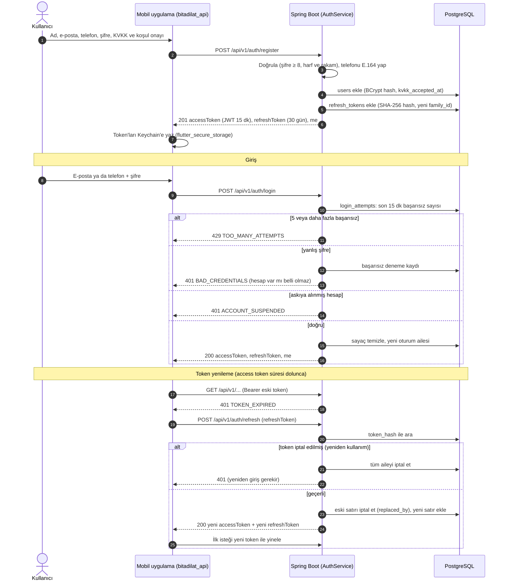

### 6.2 Talep → teklif → 3DS ödeme → iş

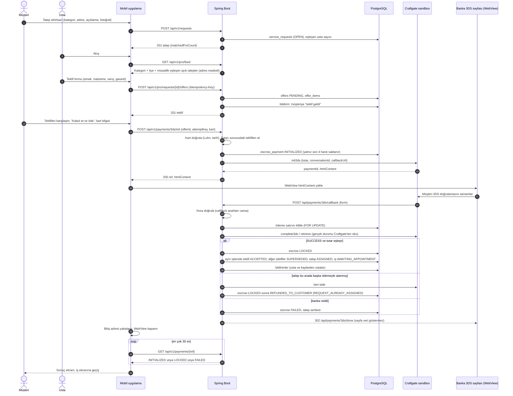

Notlar: ödeme kaydı banka çağrısı sürerken işlemsiz kaydedilir; talepte ikinci `INITIALIZED` kayıt `409 PAYMENT_IN_PROGRESS` verir. Callback gelmezse `PaymentSweeper` 30 dakikadan eski kayıtları Craftgate'e sorarak kapatır (`PaymentSweeperTest`).

### 6.3 İş durum akışı ve 48 saat otomatik tamamlama

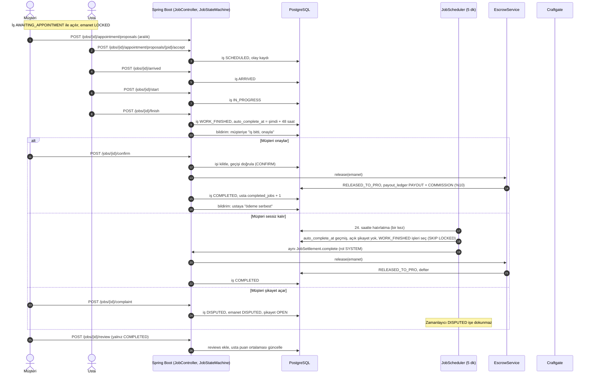

Not: otomatik tamamlama ve müşteri onayı aynı geçiştir (`Trigger.CONFIRM`) ve yarışırsa emanet iki kez serbest bırakılmaz (`confirmOrComplaintRacingTheSchedulerNeverReleasesTwice`). Bu iki yolda Craftgate'e danışılmaz; çünkü para zaten emanette tutulmuştur ve serbest bırakma yalnızca defter kaydıdır (usta ödemesi bankaya gönderilmez).

### 6.4 Şikayet → yönetici kararı

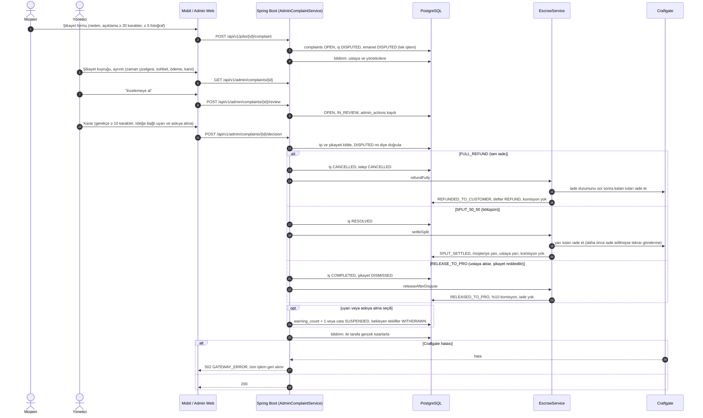

Para hareketi işlemin **en sonunda** yapılır; ağ geçidi hatasında emanet, iş ve şikayet değişmez, karar yeniden denenebilir (`gatewayFailureReturns502AndChangesNothingThenRetrySucceeds`). Craftgate'te zaman aşımına uğramış ama gerçekleşmiş bir iade ikinci kez gönderilmez (STATE_MACHINES.md bölüm 5).

---

## 7. Durum makineleri

Kaynak: `docs/spec/STATE_MACHINES.md` ve kod (`JobStateMachine`, `EscrowPayment`, `*Status` enum'ları). Geçersiz geçiş `409 ILLEGAL_STATE` döner.

### 7.1 Hesap

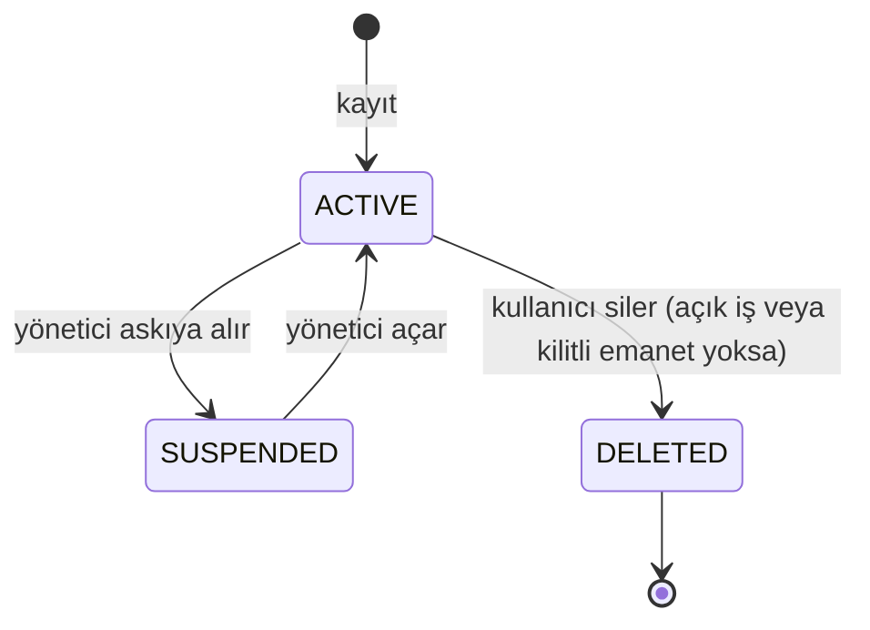

### 7.2 Usta profili (`review_status`)

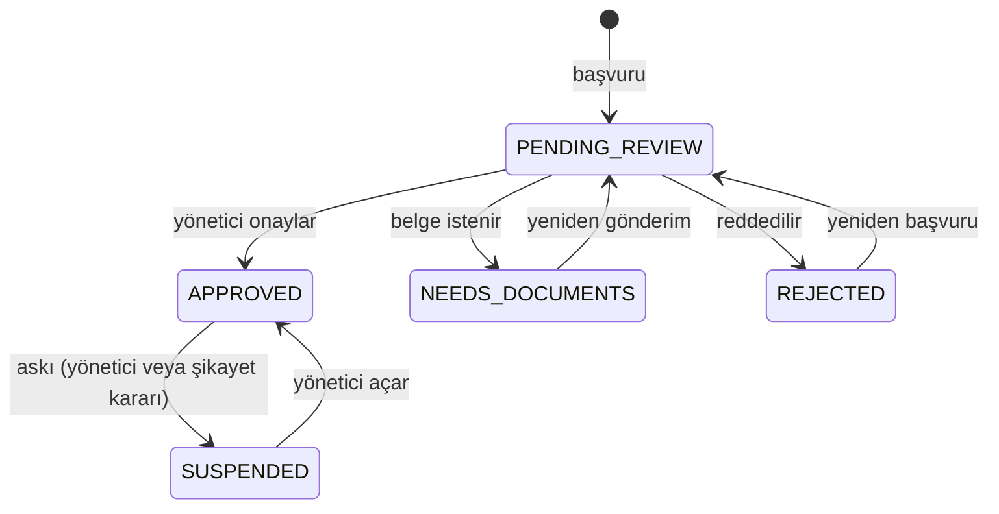

`REJECTED → PENDING_REVIEW` geçişi `STATE_MACHINES.md` içinde yazılı değildir, ancak kod buna izin verir (`ProService.submit`: yalnızca `NEEDS_DOCUMENTS` ve `REJECTED` yeniden başvurabilir) ve `ProFlowTest` içinde sınanır. Spec'e eklenmesi gerekir.

### 7.3 Talep

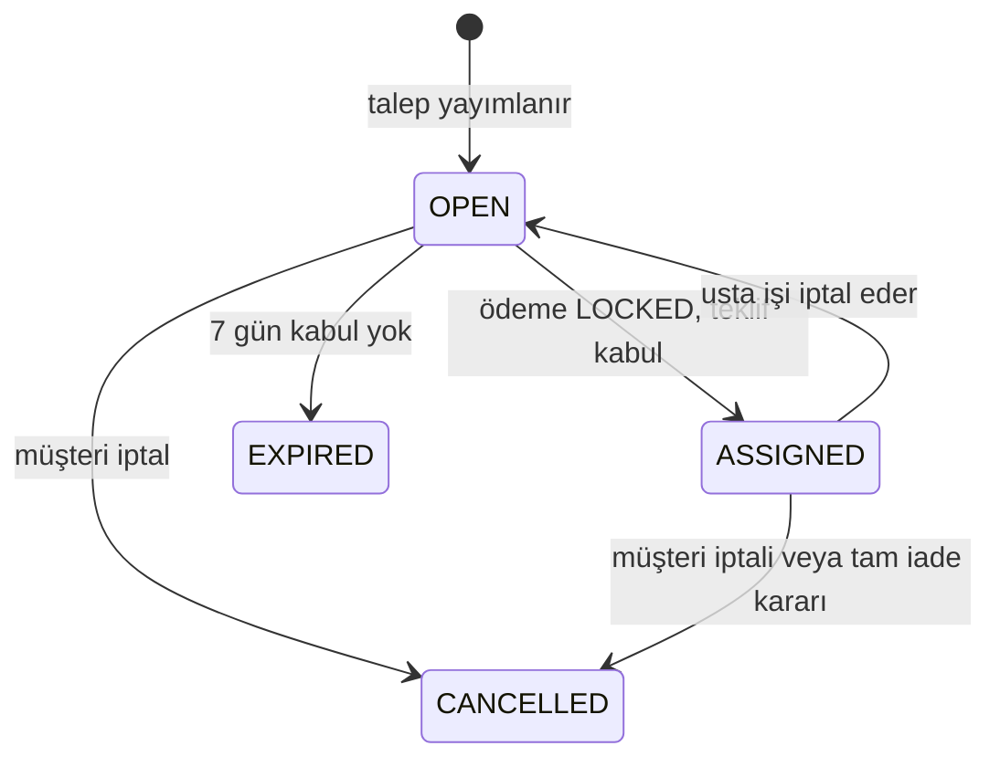

### 7.4 Teklif

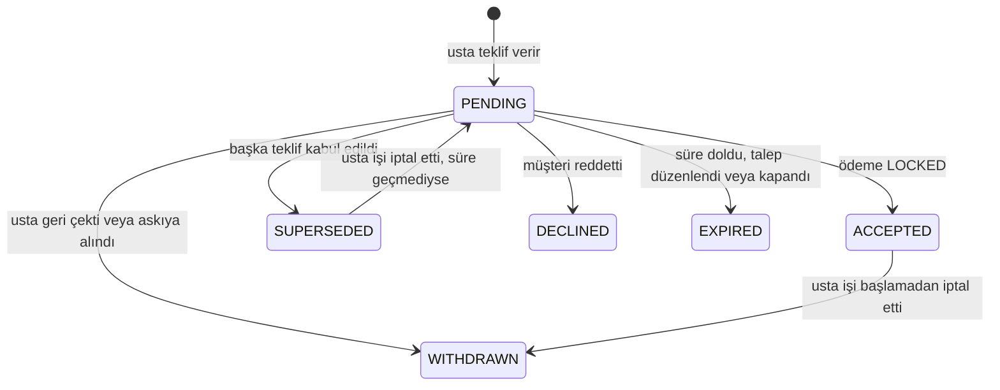

### 7.5 İş

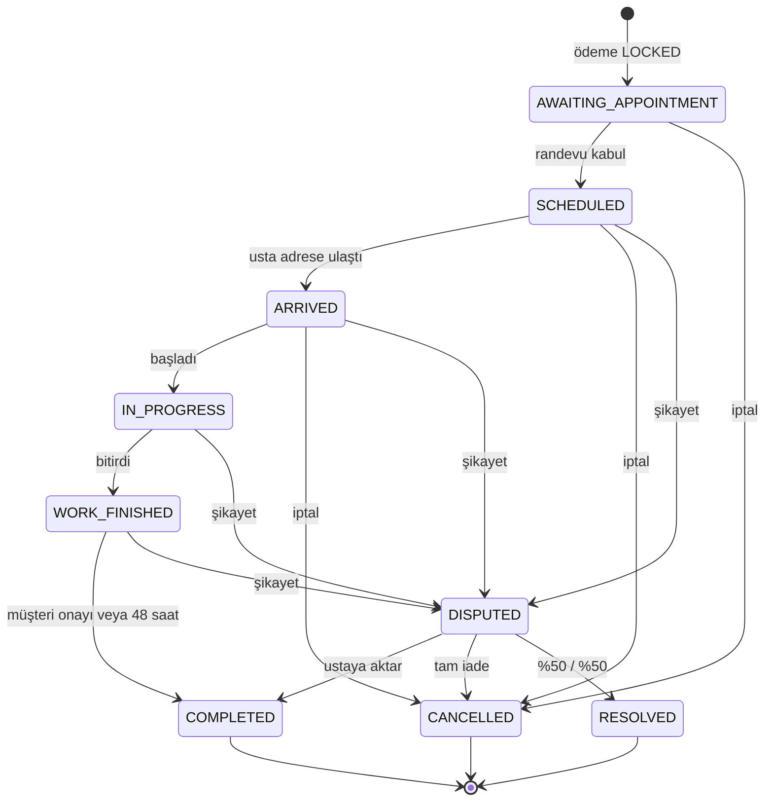

### 7.6 Şikayet

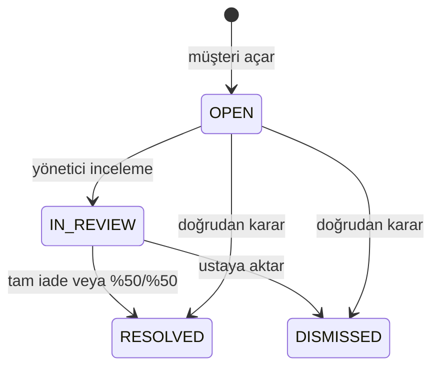

Kodda `decide` hem `OPEN` hem `IN_REVIEW` durumundan karar kabul eder; `RELEASE_TO_PRO` kararı şikayeti `DISMISSED`, diğerleri `RESOLVED` yapar (`AdminComplaintService`).

### 7.7 Emanet (`escrow_payment.status`)

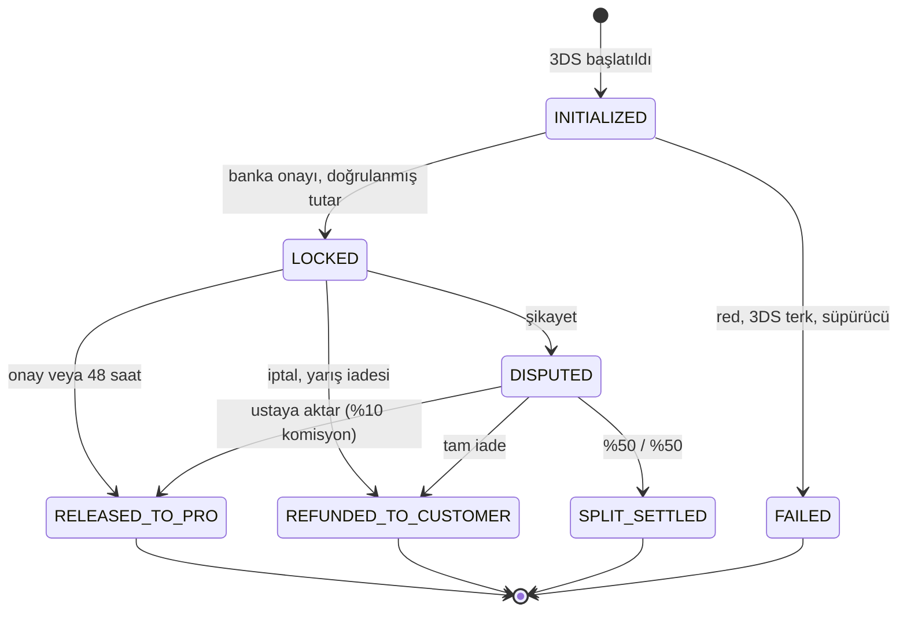

Randevu önerisi (`appointment_proposals.status`): `PENDING → ACCEPTED | SUPERSEDED | REJECTED`; bir işte tek `PENDING` olabilir.

---

## 8. Erişim ve yetki matrisi

| Kaynak / işlem | Anonim | Müşteri | Usta (onaylı) | Yönetici |
|---|---|---|---|---|
| Kayıt, giriş, şifre sıfırlama | Evet | — | — | — |
| Kategori ve ilçe listesi | Evet | Evet | Evet | Evet |
| Talep oluştur / düzenle / iptal | — | Yalnız kendi talebi | — | — |
| Talep ayrıntısı | — | Kendi talebi (tam adres) | Eşleşen talep, **adres maskeli** (ilçe ve mahalle) | — |
| Teklif ver / geri çek | — | — | Yalnız kendi teklifi | — |
| Teklifleri gör | — | Kendi talebine gelenler | Yalnız kendi teklifi (hizmet bedeli ve net kazanç yalnız ona görünür) | — |
| Ödeme başlat / sonuç | — | Yalnız kendi teklifi için | Atanmış usta sonucu görür | Görür |
| İş ayrıntısı, tam adres | — | Katılımcı müşteri | Katılımcı usta (kabul sonrası) | — |
| Sohbet | — | Yalnız o işin tarafları | Yalnız o işin tarafları | — |
| Puan ver | — | Yalnız `COMPLETED` işte, bir kez | — | — |
| Şikayet aç | — | Kendi işi | — | — |
| Usta başvurusu | — | Başvurabilir | Kendi başvurusu | Karar verir |
| Şikayet kararı, hesap askı, ödeme listesi | — | — | — | Evet (`ROLE_ADMIN`) |

Zorlama: `SecurityConfig` (`/api/v1/admin/**` için `hasRole("ADMIN")`, diğer `/api/v1/**` için kimlik), servis katmanında sahiplik denetimi (başkasının kaydı `404`). Testler: `AdminApplicationTest.everyAdminEndpointRejectsNonAdminsWith403AndAnonymousWith401`, `RequestFlowTest.otherUsersGet404ForRequestAndNeverSeeFullAddress`, `ChatTest.nonParticipantGets404EverywhereAndBodyIsValidated`, `ProFlowTest.proRequestDetailIsMaskedAndLimitedToMatchingPros`.

### Sınır koşulları (boundary conditions)

| Durum | Davranış |
|---|---|
| Sunucu ödeme sırasında kapanır | Kayıt `INITIALIZED` kalır; `PaymentSweeper` 30 dk sonra Craftgate'e sorup kapatır |
| Callback hiç gelmez (WebView kapandı) | Aynı süpürücü; müşteri `FAILED` sonrası yeniden dener |
| Aynı talebe iki müşteri ödemesi yarışır | Biri işi açar, diğeri otomatik iade edilir (`REQUEST_ALREADY_ASSIGNED`) |
| İade başarısız | Emanet `LOCKED` kalır, süpürücü artan aralıkla en çok 8 kez dener, sonra `REFUND_NEEDS_REVIEW` (elle inceleme) |
| Craftgate erişilemez | Başlatmada `502 GATEWAY_ERROR`; karar/iptalde işlem geri alınır |
| Aynı kullanıcı çok kez yanlış şifre girer | 15 dk içinde 5 başarısızdan sonra `429` |
| Eşzamanlı güncelleme | Sürüm sütunu (`version`) ile iyimser kilit; çakışma `409 ILLEGAL_STATE` |
| Yükleme kotası | 24 saatte 60 yükleme sonrası `429` |

---

## 9. Güvenlik tasarımı

**Kimlik doğrulama**

- Erişim token'ı: JWT, HS256, 15 dakika, issuer doğrulanır, sır en az 32 bayt (`JWT_SECRET`). `alg=none` ve başka sırla imzalı token reddedilir (`AuthHardeningTest`).
- Yenileme token'ı: opak rastgele değer, 30 gün. Veritabanında yalnızca SHA-256 özeti saklanır. **Döndürme (rotation):** her yenilemede eski satır iptal edilir, yenisi yazılır. **Yeniden kullanım tespiti:** iptal edilmiş token tekrar gelirse tüm aile (aynı oturum zinciri) iptal edilir. Aynı token ile eşzamanlı yenileme en çok bir oturum üretir (`parallelRefreshWithSameTokenYieldsAtMostOneSession`). Access token içindeki `family` claim'i, şifre değişince diğer oturumların kapanmasını sağlar.
- Şifre: BCrypt (Spring `BCryptPasswordEncoder`), en az 8 karakter, harf ve rakam, en çok 72 bayt.
- Kaba kuvvet koruması: hesap başına (e-posta ve telefon aynı sayaç) 15 dakikada 5 başarısız deneme. Hesap yoksa da sahte hash karşılaştırılır; yanıt hesap varlığını sızdırmaz. Şifre sıfırlama kodu: özet olarak saklanır, 15 dk geçerli, 5 yanlış denemede geçersiz, saatte en çok 5 kod.
- İstemci: mobilde token'lar iOS Keychain'de (`first_unlock_this_device`, iCloud eşitlemesi kapalı, `secure_token_store_test.dart`). Yönetim panelinde token yalnızca **bellekte** tutulur (`MemoryTokenStore`); sayfa yenilenince oturum biter.

**Yetkilendirme**

- Durumsuz (stateless) oturum, CSRF kapalı (çerez kullanılmaz), CORS yalnızca yapılandırılan kaynaklara. Banka callback yolları CORS dışıdır (üst düzey form POST).
- Rol: `users.is_admin` → `ROLE_ADMIN`. Müşteri ve usta ayrımı kaynak sahipliği ve `pro_profiles.review_status = APPROVED` ile sağlanır.
- Hata gövdeleri ayrıntı sızdırmaz (`server.error.include-message=never`, stack trace kapalı).

**Veri koruma**

- **Adres şifreleme:** `addresses.line_full_encrypted` ve `door_note_encrypted` AES-256-GCM ile şifrelenir. Çıktı `base64(iv[12] | şifreli metin | etiket[16])`; her şifrelemede rastgele IV, aynı metin farklı çıktı verir. **AAD** olarak kullanıcı kimliği bağlanır; başka satıra kopyalanan değer çözülmez. Anahtar `ADDRESS_KEY` ortam değişkenidir (veritabanında yok). Mahalle ve ilçe şifrelenmez (eşleştirme için gerekli). Tam adres yalnızca kabul sonrası, işin tarafları için döner. Testler: `AccountTest.addressIsEncryptedAtRestAndReadableThroughApi`, `sameTextEncryptsDifferentlyEachTime`, `CommonRulesTest.aesGcmRoundTripBindsToAad`.
- **İmzalı medya URL'leri:** medya içeriği `GET /api/v1/media/{id}/content?exp=...&sig=...` ile sunulur; imza `HMAC-SHA256(MEDIA_SIGNING_KEY, "id.exp")`, geçerlilik 10 dakika. İmza yalnızca erişim denetiminden geçen çağırana üretilir (`signaturesAreOnlyIssuedAfterAccessChecks`). Dosya türü uzantıya göre değil **sihirli baytlarla** doğrulanır (`typeIsCheckedByMagicBytesNotByNameOrPurpose`); PDF `attachment` olarak sunulur.
- **Kart verisi:** kart numarası ve CVC saklanmaz, loglanmaz, yanıtta dönmez; yalnızca son 4 hane kaydedilir (`cardDataIsNeverLoggedOrReturned`). `CardDetails.toString()` gizlidir. Ödeme tutarı her zaman sunucudaki tekliften alınır; istemcinin gönderdiği tutar yok sayılır. Callback sonucu istemci parametrelerine değil Craftgate sorgusuna göre karara bağlanır (`forgedSuccessIsDecidedByCraftgateNotByParams`). **Not:** callback imza doğrulaması yalnızca `craftgate.callback-key` doluysa yapılır; boşsa doğrulama atlanır ve güvenlik Craftgate sorgusuna dayanır.
- **Hesap silme:** kişisel veriler anonimleştirilir; finansal kayıtlar yasal süre boyunca kalır. Açık işi ya da kilitli emaneti olan hesap silinemez.
- **Denetim izi:** yönetici eylemleri `admin_actions` tablosuna yazılır.

**KVKK notları (6698)**

| Konu | Durum |
|---|---|
| Açık rıza ve aydınlatma | Kayıtta KVKK ve koşul onay kutusu zorunlu; `kvkk_accepted_at`, `terms_accepted_at` saklanır. Hukuki metinler yer tutucudur, hukuk incelemesi yapılmadı |
| Silme hakkı | Hesap silme (anonimleştirme) var |
| Veri minimizasyonu | Adres şifreli, usta telefon/e-posta herkese açık profilde yok, müşteri telefonu ustaya gösterilmez |
| Saklama süresi politikası | **Yok** (tanımlı değil) |
| Veri taşınabilirliği / dışa aktarım | **Yok** |
| Aktarım güvenliği | HTTPS dağıtımda gereklidir; yerel geliştirmede HTTP (yalnız Debug, ATS istisnası `platform_config_test.dart`) |
| Üçüncü taraf | Craftgate yalnızca ödeme için; kart verisi BiTadilat'ta tutulmaz |

---

## 10. Arayüz ve erişilebilirlik tasarımı

- Dokunma hedefi en az **48 dp** (`AppSizes.minTouch`, `components_test.dart`); metin kontrastı WCAG 2.1 AA (≥ 4.5:1, `contrast_test.dart`). Tasarım belgelerinde geçen "44 pt" eskidir.
- TR/EN canlı geçiş: `gen-l10n`; hem mobil hem admin. Tüm hata kodları için iki dilde mesaj vardır (`auth_screens_test.dart: her ApiErrorCode için TR ve EN mesaj var`).
- Geri döndürülemez eylemlerde onay: teklif kabulü (ayrı onay ekranı, ardından ödeme), iptal, tamamlama onayı, şikayet, hesap silme, yönetici kararı (onay diyaloğu).
- 320 px genişlik ve 2x yazı ölçeğinde taşma testleri bileşen ve ekran düzeyinde vardır.

---

## 11. RAD'dan sapmalar

Aşağıdaki değişiklikler proje sahibinin kararıdır. RAD metni **güncellenmemiştir**; `docs/PAYMENT_RAD_CHANGE_NOTE.md` ödeme değişikliği için ekip ve danışman onayını bekler.

| # | RAD'da | Yapılan | Gerekçe / kanıt |
|---|---|---|---|
| 1 | Ödeme kapsam dışı (RAD 1.2) | Craftgate **sandbox** 3DS ödeme + backend **emanet defteri**, %10 komisyon; usta ödemesi yalnızca kaydedilir | `PAYMENT_RAD_CHANGE_NOTE.md`; UC05, UC09, UC11, UC13 etkilenir |
| 2 | Telefon + SMS kodu ile giriş (SCR-01) | **E-posta veya telefon + şifre**; kayıtta KVKK onayı, e-posta kodu ile şifre sıfırlama, hesap silme, tek hesapta müşteri/usta modu | SMS sağlayıcısı yok; telefon yalnızca tanımlayıcı |
| 3 | Backend sorumlusu takım üyesi | Backend **Spring Boot 4.1 / Java 21 / PostgreSQL 16 / Flyway** olarak yazıldı | Takım dalındaki NestJS iskeleti kullanılmıyor |
| 4 | "Web tabanlı yönetim paneli", çatı belirtilmemiş | **Flutter Web** (`apps/admin`), aynı depoda, ortak paketlerle | Tek dil ve ortak API istemcisi |
| 5 | Android APK ve iOS | **iOS öncelikli**; Android sonraya bırakıldı (iskelet var, sınanmadı) | Simulator ile uçtan uca sınanıyor |
| 6 | Karşılıklı tamamlama onayı; iş durumları `AGREED`…`COMPLETED` | Müşteri onayı **veya 48 saat sonra otomatik aktarım**; durum kümeleri tekleştirildi (`AWAITING_APPOINTMENT`…`RESOLVED`) | `STATE_MACHINES.md` bölüm 7 eşleme tablosu |
| 7 | Randevu: karşılıklı kabul | Usta onaylar ya da yeni aralık önerir | `JobFlowTest.appointmentProposalAcceptanceRescheduleAndCounterProposal` |
| 8 | İlerleme: genel durum | Adrese ulaştım → başladım → bitirdim | `JobStateMachine` |
| 9 | İptal: genel | Yalnızca iş başlamadan; sonrası şikayet; şikayet açıkken iptal/iade kapalı | `cancelIsRefusedFromInProgressOnward` |
| 10 | Şikayet hakemliği: genel | Tam iade, %50/%50 (komisyonsuz), ustaya aktar (%10 komisyon); uyarı ve askıya alma | `AdminComplaintTest` |
| 11 | Push bildirim (FCM/APNs) | **Uygulama içi bildirim merkezi** (19 tür); push yok | Apple geliştirici hesabı ve Firebase gerekir |
| 12 | Sohbet | Yoklama (3 sn), websocket yok; iş kapandıktan 30 gün sonra salt okunur | `chat_wave3_test.dart` |
| 13 | Dokunma hedefi 48 dp | 48 dp korundu (tasarım belgeleri 44 pt diyor) | `tokens.dart` |
| 14 | Docker ile paketli backend | **Yok** | Açık iş |
| 15 | Tanıtım sitesi (UC14) | **Yok** | Açık karar |
| 16 | RAD ekranları | Eklenenler: kazançlar, tekliflerim, bildirim merkezi, kayıtlı adresler, ödeme sonucu | `docs/spec/ROLE_SCREEN_MAP.md` |

Prototipe özgü ifadeler ("komisyonsuz", "%100 Garantili", garanti süreleri) uygulama metinlerinden çıkarılmalıdır; bu belge onları gerçekleştirilmiş davranış olarak saymaz.

---

## 12. Açık noktalar

- Tanıtım sitesi, push bildirim, Docker, Android derlemesi, gerçek e-posta/SMS ve KVKK saklama/dışa aktarım politikası gerçekleştirilmedi (bkz. 1 ve 9).
- Kullanılabilirlik (%80, 5 kullanıcı), süre hedefleri (3 dk / 90 sn), erişilebilirlik süresi (%99,5) ve gecikme (500 ms) ölçülmedi. Plan: `USABILITY_STUDY.md`, `TEST_PLAN.md`.
- `REJECTED → PENDING_REVIEW` (yeniden başvuru) geçişi kodda var, `STATE_MACHINES.md`'de yok; spec güncellenmelidir (7.2).
