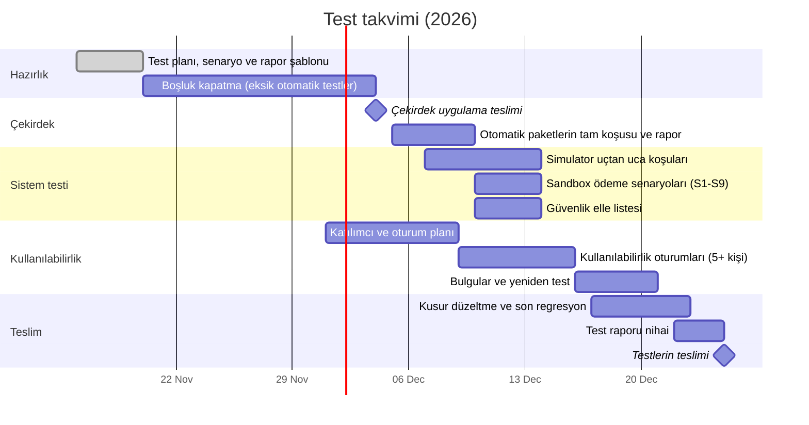

# BiTadilat — Test Planı

| | |
|---|---|
| Belge | Test Planı (D5.2 girdisi) |
| Sürüm | 0.2, 19 Kasım 2026 (0.1: 16 Kasım) |
| Kod tabanı | `feature/flutter-app`, işlem c335a10 (0.1: 565bfb4) |
| İlgili belgeler | `TEST_CASES.md` (senaryolar ve izlenebilirlik), `TEST_REPORT_TEMPLATE.md` (sonuç raporu), `USABILITY_STUDY.md` (kullanılabilirlik), `SDD.md` |
| Teslim | Testlerin teslimi: **25 Aralık 2026** (RAD 4.2) |

## 1. Amaç ve kapsam

Amaç, RAD'daki 14 kullanım durumunun (UC01–UC14), 7 hedefin başarı ölçütlerinin ve işlevsel olmayan gereksinimlerin (NFR) gerçekleştirilen sistemde sağlandığını **kanıtlamak** ve sağlanmayanları dürüstçe kaydetmektir.

**Kapsamda**

- Spring Boot API (`backend/`): iş kuralları, durum makineleri, yetkilendirme, ödeme/emanet, zamanlayıcılar, Flyway şeması.
- Mobil uygulama (`apps/mobile`): ekranlar, rota korumaları, yerelleştirme, platform yapılandırması.
- Yönetim paneli (`apps/admin`).
- Ortak paketler: `packages/bitadilat_api` (istemci, modeller, token yenileme), `packages/bitadilat_ui` (bileşenler, kontrast, yazı tipi).
- Craftgate **sandbox** ödeme akışı (3D Secure, iade).
- Kullanılabilirlik çalışması (ayrı belge).

**Kapsam dışında**

- Tanıtım sitesi (UC14, `website/`): yapıldı ama **otomatik test yok**; içerik koddaki kurallarla elle karşılaştırılır, tarayıcıda görsel kontrol elle yapılır (`TEST_CASES.md` TC-PROMO-01). Yasal metin taslaklarının uygulama kopyası otomatik karşılaştırılır (TC-PROMO-02).
- Push bildirimi: bilinçli olarak yapılmadı (yalnızca uygulama içi bildirim).
- Android derlemesi: sınanmayacak (iOS öncelikli); platform dosyaları için yalnızca yapılandırma testi var, APK derlenmedi.
- Docker imajı ve `docker compose`: dosyalar var, bu makinede Docker olmadığından çalıştırılmadı (elle bekliyor, TC-NFR-EXT-05). GitHub Actions iş akışları uzak depoda koşturulmadı (TC-NFR-EXT-06).
- Gerçek para, canlı Craftgate hesabı, canlı e-posta (SMTP)/SMS; telefon değişikliği ve "ustaya soru sor" yapılmadığından sınanmaz.
- Yük ve dayanıklılık testi (bkz. 8, risk R4).

## 2. Test seviyeleri

| Seviye | Ne sınanır | Araç | Nerede | Otomatik mi |
|---|---|---|---|---|
| Birim | Saf mantık: kart doğrulama (Luhn), telefon E.164, şifre kuralı, AES-GCM, para yuvarlama, token değerleri, kontrast hesabı | JUnit 5, `flutter_test` | `CardValidatorTest`, `CommonRulesTest`, `components_test.dart`, `contrast_test.dart` | Evet |
| Entegrasyon (API + gerçek PostgreSQL) | HTTP uç noktaları, kısıtlar, işlemler, kilitler, zamanlayıcılar, durum makineleri | Spring Boot Test + MockMvc, gerçek PostgreSQL 16 (Docker varsa Testcontainers, yoksa yerel `bitadilat_test`), Mockito ile sahte `PaymentGateway` | `backend/src/test/java/com/bitadilat/**` (354 test) | Evet |
| Eşzamanlılık | Yarışlar: aynı talebe iki ödeme, eşzamanlı yenileme, eşzamanlı karar, eşzamanlı mesaj | Çok iş parçacıklı JUnit testleri, kısmi benzersiz indeksler, satır kilidi | `PaymentAppTest`, `AuthHardeningTest`, `AdminComplaintTest`, `ChatTest`, `RequestFlowTest`, `PaymentSweeperTest`, `JobFlowTest`, `EscrowSafetyTest`, `AdminPaymentReviewTest` | Evet |
| İstemci paketi (sözleşme) | JSON ↔ model, uç nokta yolları, hata kodları, token yenileme interceptor'u | `flutter_test`, sahte `HttpClientAdapter` | `packages/bitadilat_api/test` (112 test) | Evet |
| Widget / ekran | Ekran akışları, doğrulama, hata durumları, rota korumaları, TR/EN, 320 px ve 2x yazı taşma | `flutter_test` widget testleri, sahte HTTP bağdaştırıcısı (`FakeAdapter`) | `apps/mobile/test` (567), `apps/admin/test` (95), `packages/bitadilat_ui/test` (27) | Evet |
| Üretim hazırlığı | `prod` profili: varsayılan sır yok, dev bean'leri yok, callback anahtarı ve SMTP zorunlu, ilk yönetici (bootstrap) | JUnit, tam uygulama bağlamı | `prod/ProdProfileContextTest`, `ProdReadinessUnitTest`, `AdminBootstrapTest`, `common/ProdProfileConfigTest` | Evet |
| Platform yapılandırması | iOS/Android paket kimliği, ATS istisnası yalnız Debug, ikon, izin dizeleri, depolama güvenliği | `flutter_test` dosya okuma | `platform_config_test.dart`, `secure_token_store_test.dart` | Evet |
| Uçtan uca (Simulator ve tarayıcı) | Gerçek sunucu + gerçek uygulama: kayıt → talep → teklif → ödeme → iş → onay; admin kararı | iOS Simulator, Chrome (Flutter Web), gerçek backend + PostgreSQL | Elle ve sürücü betikleriyle | **Kısmen / elle**; depoda otomatik uçtan uca test **yok** (`integration_test` dizini yok). Önceki E2E raporları kayboldu; 25 Aralık'a kadar yeniden koşulup kayda geçirilecek |
| Sandbox ödeme | Gerçek Craftgate sandbox: 3DS başlatma, callback, iade, kısmi iade | Craftgate sandbox test kartları, çalışan backend | Elle (aşağıda 6) | Hayır. Otomatik testlerde ağ geçidi sahtedir; `CraftgateGatewayTest` yalnızca eşleme mantığını sınar |
| Güvenlik | Yetkisiz erişim, token sahteciliği, kaba kuvvet, imza, IDOR, adres sızıntısı | JUnit (otomatik) + elle sızma listesi | `AuthFlowTest`, `AuthHardeningTest`, `MediaTest`, `AdminApplicationTest` | Büyük ölçüde |
| Kullanılabilirlik | Başarı oranı, süre, SUS | Moderatörlü oturum | `USABILITY_STUDY.md` | Hayır (insanla) |
| Performans / erişilebilirlik süresi | API okuma gecikmesi, uptime | Küçük gecikme betiği, sağlık uç noktası | **Hazır değil** | Hayır |

## 3. Test ortamı

| Öğe | Değer |
|---|---|
| İşletim sistemi | macOS (geliştirme makinesi) |
| Java / Spring | OpenJDK 21, Spring Boot 4.1.2 |
| Veritabanı | PostgreSQL 16. Testler `bitadilat_test` (veya `TEST_DB_URL` ile verilen) veritabanını **her bağlamda siler ve yeniden kurar** (`flyway.clean()`); geliştirme veritabanına yönlendirilmemelidir |
| Flutter | Çalışma alanı (`pubspec.yaml` workspace): `apps/mobile`, `apps/admin`, `packages/*`, Dart SDK ^3.13 |
| iOS | iOS Simulator (Xcode), dağıtım hedefi iOS 16.0 |
| Tarayıcı | Chrome (admin paneli) |
| Ödeme | Craftgate sandbox (`sandbox-api.craftgate.io`), sandbox API anahtarı ortam değişkeni ile |
| Veri | `dev` profili tohum verisi (`docs/spec/SEED_DATA.md`), `POST /api/v1/dev/reset` ile sıfırlanır; yalnızca loopback |
| Gizli bilgi | Test anahtarları `backend/src/test/resources/application.properties` içinde sabit test değerleridir; gerçek anahtar depoya girmez |

Komutlar:

```bash
# Backend (tüm testler; yerel PostgreSQL gerekir, Docker varsa konteyner kullanılır)
cd backend && ./mvnw -q -B test
# Paralel koşan başka bir çalışmayla çakışmamak için ayrı veritabanı:
#   createdb bitadilat_test_x && TEST_DB_URL=jdbc:postgresql://localhost:5432/bitadilat_test_x ./mvnw -B test

# Flutter (çalışma alanı kökünde bir kez: flutter pub get)
cd apps/mobile            && flutter test
cd apps/admin             && flutter test
cd packages/bitadilat_ui  && flutter test
cd packages/bitadilat_api && flutter test
```

## 4. Giriş ve çıkış kriterleri

**Giriş (bir test turuna başlamak için)**

1. Kod `feature/flutter-app` üzerinde, çalışma ağacı temiz ve işlem numarası kayda geçirilmiş.
2. `flutter pub get` ve `./mvnw -B compile` hatasız.
3. PostgreSQL ayakta, test veritabanı erişilebilir.
4. `TEST_CASES.md` güncel (yeni özellik varsa senaryosu yazılmış).

**Çıkış (turu "geçti" saymak için)**

1. Otomatik paketlerin **tamamı yeşil**: backend, mobil, admin, ui, api. Atlanan (skipped) test yok ya da gerekçeli.
2. `TEST_CASES.md`'deki her **Yüksek öncelikli UC** için en az bir otomatik test ya da kanıtlı elle koşu var; "boşluk" olarak işaretli satır kalıyorsa gerekçesi `TEST_REPORT` içinde.
3. Açık kusur günlüğünde **Kritik** ve **Yüksek** önem derecesinde açık kusur yok.
4. Sandbox ödeme senaryoları (6) bir kez baştan sona koşulmuş ve kayda geçmiş.
5. Kullanılabilirlik çalışması yapılmış ve sonuç tablosu doldurulmuş (başarı oranı ≥ %80 ya da sapma gerekçesi).

## 5. Test edilecek özellikler ve öncelik

| Öncelik | Özellik | Neden |
|---|---|---|
| Yüksek | Kimlik doğrulama, yetki, adres gizliliği (UC01, hedef 5) | Güvenlik ve KVKK |
| Yüksek | Talep → teklif → ödeme → iş zinciri (UC02–UC05, UC08, UC09) | Ana değer akışı |
| Yüksek | Emanet defteri ve iade (UC05, UC09, UC11, UC13) | Para hareketi |
| Yüksek | Yönetici işlemleri (UC12, UC13) | Geri alınamaz kararlar |
| Orta | Randevu, sohbet, puan (UC06, UC07, UC10) | RAD "Orta" |
| Orta | TR/EN, erişilebilirlik, düzen | NFR |
| Düşük | Tanıtım sitesi (UC14) | Gerçekleştirilmedi |

## 6. Sandbox ödeme test planı (elle)

Önkoşul: çalışan backend (`dev` profili), sandbox API anahtarları ortam değişkeninde, 3DS callback adresi erişilebilir, Simulator'da müşteri ve usta hesabı (tohum veri).

| Adım | Senaryo | Beklenen |
|---|---|---|
| S1 | Craftgate'in yayımladığı başarılı test kartı ile teklif kabulü | 3DS sayfası açılır, doğrulama sonrası ödeme `LOCKED`, teklif `ACCEPTED`, iş açılır |
| S2 | Reddedilen test kartı | Ödeme `FAILED`, mesaj gösterilir, talep serbest, yeniden denenebilir |
| S3 | 3DS penceresi doğrulama yapılmadan kapatılır | 3DS tamamlanmamışsa süpürücü kaydı oluşturmadan **2 saat** sonra `FAILED / THREEDS_ABANDONED` yapar; hemen yeni deneme istenirse eski deneme ≥ 10 dk ve Craftgate "3DS bitmedi" diyorsa o anda kapanır, değilse `409` |
| S4 | Müşteri onaylar | Emanet `RELEASED_TO_PRO`, defterde `PAYOUT` ve `COMMISSION` (%10) |
| S5 | İptal (iş başlamadan) | Craftgate'te tam iade görünür, emanet `REFUNDED_TO_CUSTOMER` |
| S6 | Şikayet + tam iade | Tam iade bir kez gider |
| S7 | Şikayet + %50/%50 | Yarı tutar iade, `SPLIT_SETTLED`, komisyon yok |
| S8 | Şikayet + ustaya aktar | İade yok, `RELEASED_TO_PRO`, %10 komisyon |
| S9 | Aynı kartla iki kez hızlı deneme | `409 PAYMENT_IN_PROGRESS` ya da `DUPLICATE_ATTEMPT` |
| S10 | Şikayet + kısmi iade durumu: Craftgate'te kısmi iade varken tam iade kararı | Yalnızca kalan tutar iade edilir, müşteri toplamı tam bir kez alır |
| S11 | İade edilmiş ödemede müşteri onayı (aktarım) | Aktarılmaz, `PAYOUT_NEEDS_REVIEW`; admin çözümü yalnızca izinli seçenekleri sunar |

Sandbox kart numaraları Craftgate belgelerinden alınır; bu belgeye ve depoya yazılmaz. Kasım 2026'da iade ve aktarım senaryoları gerçek sandbox'ta elle koşuldu (bölüşüm, tam iade, kısmi iade + kalan, iadeden sonra aktarımın reddi; ödeme no 3275432, 3275434, 3275436, 3281697; kayıt: `TEST_REPORT_TEMPLATE.md` C.5). Ret, terk ve çift deneme (S2, S3, S9) koşulmadı. 16 Kasım 2026'da gerçek Craftgate sandbox ile uçtan uca bir koşu yapılmıştır (proje sahibinin kaydı); ayrıntılı çıktısı depoda **yoktur**, S1–S9 yeniden koşulup `TEST_REPORT` içine işlenecektir.

## 7. Veri yönetimi

- Otomatik testler her bağlamda şemayı baştan kurar; test sırası bağımsızdır.
- E2E ve elle testler için `POST /api/v1/dev/reset` tohum veriyi geri yükler (yalnızca `dev` profili ve loopback; `DevSeedTest.resetIsRefusedFromNonLoopbackAddress`).
- Kullanılabilirlik katılımcıları gerçek kişisel veri girmez; tohum hesaplar ve uydurma adres kullanılır.

## 8. Riskler

| # | Risk | Etki | Önlem |
|---|---|---|---|
| R1 | Uçtan uca testler otomatik değil, önceki raporlar kayıp | Regresyon kaçar, kanıt eksik | Her E2E koşusunu tarih + işlem numarası + ekran görüntüsü ile `TEST_REPORT`'a yaz; mümkünse Simulator sürücü betiğini depoya al |
| R2 | Ağ geçidi otomatik testlerde sahte; gerçek Craftgate davranışı otomatik doğrulanmıyor | Sandbox sürümü değişirse fark edilmez | Bölüm 6 elle koşuları; ağ geçidi hatası senaryoları sahte ile kapsanır |
| R3 | Testler paylaşılan PostgreSQL'i siler | Başka bir koşu bozulur | Koşu başına ayrı `TEST_DB_URL` |
| R4 | Erişilebilirlik süresi (%99,5) ve gecikme (500 ms) ölçülemiyor: sağlık uç noktası ve izleme yok | NFR kanıtsız | Hafif bir `/health` ve gecikme betiği ekle ya da hedef olarak yeniden ifade et (proje sahibi kararı) |
| R5 | Kullanılabilirlik için 5 katılımcı bulunamaz | Hedef 6 kanıtsız | Katılımcıları Aralık başında planla (`USABILITY_STUDY.md`) |
| R6 | Android hiç derlenmedi; Docker imajı ve CI uzakta koşturulmadı | RAD "APK" ve paketleme vaadi | Kapsam dışı ilan et ya da Aralık'ta derleme duman testi; Docker olan bir makinede `docker compose up --build` |
| R7 | Apple geliştirici hesabı yok | Gerçek cihazda test yok | Yalnızca Simulator; bunu raporda belirt |
| R8 | Yasal metinler taslak (hukukçu incelemesi yok), site ve uygulama kopyaları elle eşitleniyor | Hukuki risk, kopya sapması | Hukuk incelemesi kapsam dışı, raporda belirt; uygulama kopyası testle korunur, site kopyası elle |
| R9 | `dev` profilinde e-posta yok: şifre sıfırlama ve e-posta değişikliği kodları log'da; `prod` SMTP'si gerçek sağlayıcıyla denenmedi | E2E'de kod elle alınır | Test sırasında log'dan oku; testlerde `CapturingEmailSender`; SMTP için birim testi var |

## 9. Takvim

RAD'daki sabit tarihler: çekirdek uygulama 4 Aralık, **testlerin teslimi 25 Aralık**, tez ve kaynak kod 2 Ocak, poster 8 Ocak.



Bu takvim bir **taslaktır**; jüri tarihi onaylanmamıştır. Katılımcı bulma ve moderatör ataması proje sahibinin kararına bağlıdır.

## 10. Roller

| Rol | Sorumluluk |
|---|---|
| Proje sahibi | Kapsam, öncelik, kusur önceliklendirme, kullanılabilirlik katılımcıları |
| Geliştirici (Claude ile birlikte) | Otomatik testler, kusur düzeltme, rapor çıktısı |
| Moderatör / gözlemci | Kullanılabilirlik oturumları (iki kişi önerilir: biri yönetir, biri not alır) |

Takım üyelerinin RAD'daki rol dağılımı bu projede gerçekleşen çalışmayı yansıtmıyorsa raporda dürüstçe yazılmalıdır; bu bir proje sahibi kararıdır.

## 11. Kusur yönetimi

- Kusurlar `TEST_REPORT_TEMPLATE.md` içindeki kusur günlüğüne yazılır: kimlik, tarih, işlem numarası, adım, beklenen/gerçekleşen, önem, durum, düzeltme işlemi.
- Önem: **Kritik** (para/veri kaybı, güvenlik), **Yüksek** (ana akış kırık), **Orta** (geçici çözümü var), **Düşük** (kozmetik).
- Her düzeltme, kusuru yeniden üreten bir otomatik test ile kapatılır (önce kırmızı, sonra yeşil).
- Kapanış: düzeltme işlemi + yeşil test + günlükte "Kapalı".

## 12. Teslim edilecekler

| Çıktı | Dosya |
|---|---|
| Test planı | `docs/deliverables/TEST_PLAN.md` |
| Test senaryoları ve izlenebilirlik | `docs/deliverables/TEST_CASES.md` |
| Test raporu (sayılar, sonuçlar, kusur günlüğü) | `docs/deliverables/TEST_REPORT_TEMPLATE.md` doldurulmuş kopya |
| Kullanılabilirlik çalışması | `docs/deliverables/USABILITY_STUDY.md` + sonuç tablosu |
| Otomatik test kaynakları | `backend/src/test`, `apps/*/test`, `packages/*/test` |
